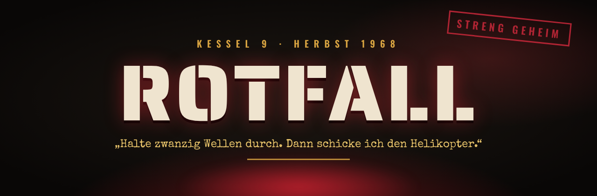
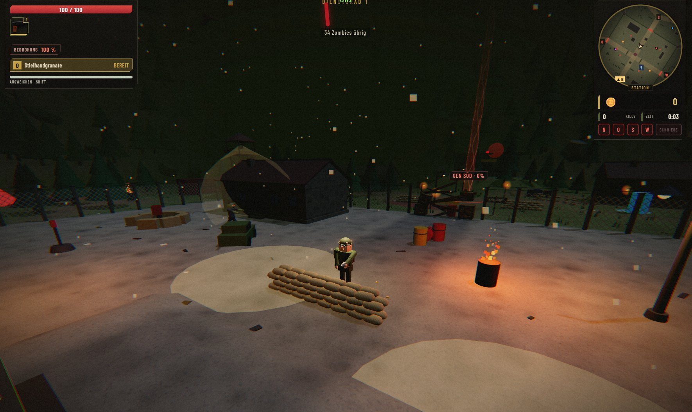
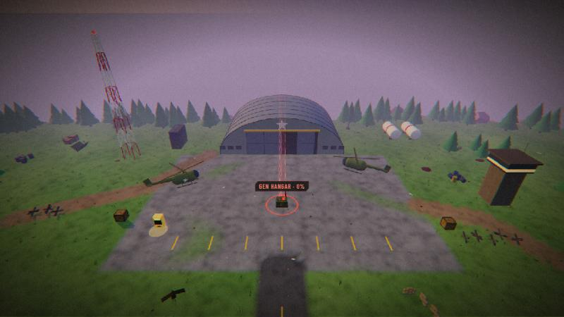
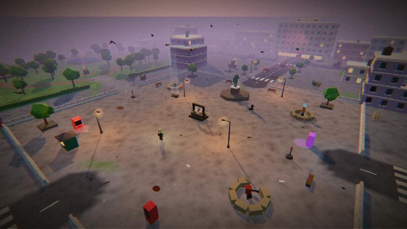
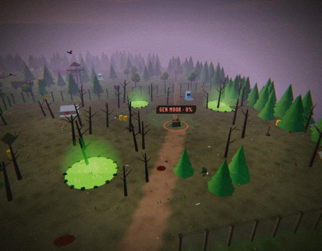
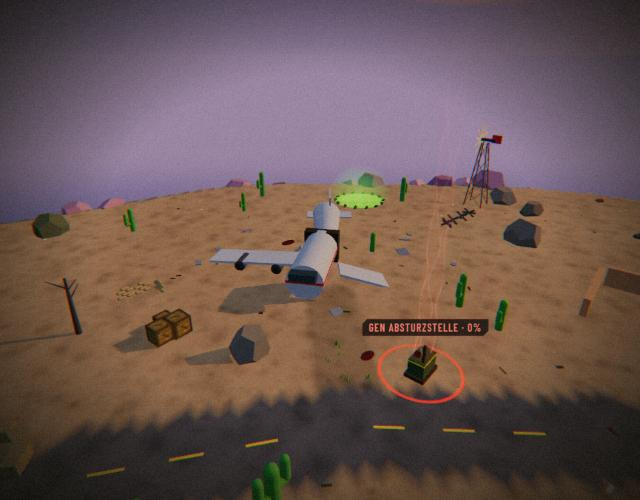
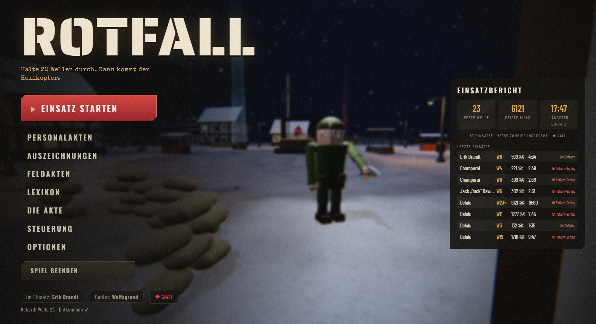
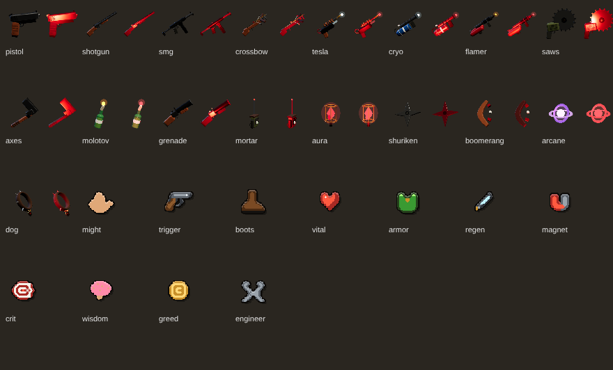
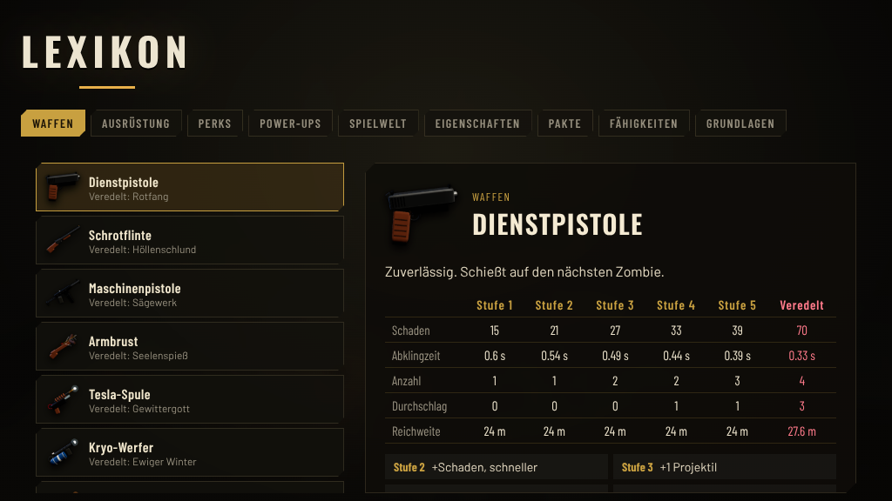
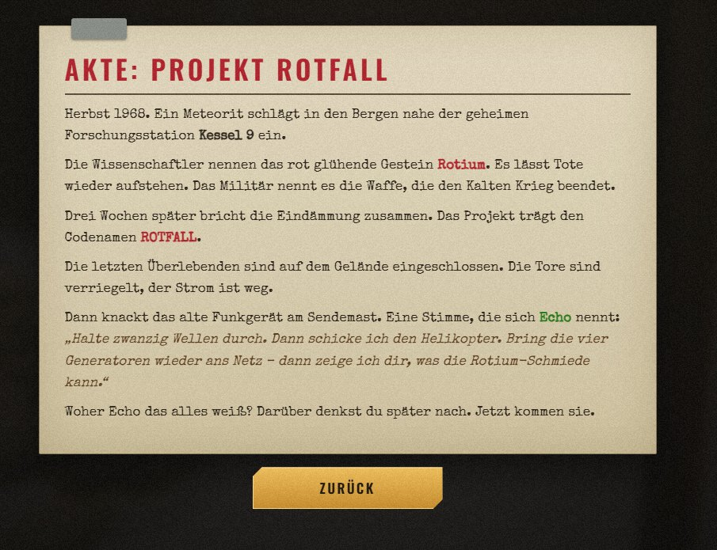

  

  
  
  

<h3 align="center">
  <a href="https://github.com/beydo7/rotfall-releases/releases/latest">⬇️ &nbsp;JETZT KOSTENLOS SPIELEN&nbsp; ⬇️</a>
</h3>

<b>Ohne Download:</b> <a href="https://beydo7.github.io/rotfall-releases/play/">▶ Direkt im Browser spielen</a> (Chrome oder Edge)

  <a href="https://github.com/beydo7/rotfall-releases/issues/new?template=1-fehler.yml">🐛 Fehler melden</a> &nbsp;·&nbsp;
  <a href="https://github.com/beydo7/rotfall-releases/issues/new?template=2-idee.yml">💡 Idee einreichen</a>

---

> **Herbst 1968.** Ein Meteorit schlägt in den Bergen nahe der geheimen Forschungsstation **Kessel 9** ein.
> Die Wissenschaftler nennen das rot glühende Gestein **Rotium**. Es lässt Tote wieder aufstehen.
>
> Drei Wochen später bricht die Eindämmung zusammen. Die Tore sind verriegelt, der Strom ist weg.
> Dann knackt das alte Funkgerät am Sendemast. Eine Stimme, die sich **Echo** nennt:
>
> *„Halte zwanzig Wellen durch. Dann schicke ich den Helikopter.“*
>
> Woher Echo das alles weiß? Darüber denkst du später nach. **Jetzt kommen sie.**

  

## 🧟 Worum geht es?

**ROTFALL** ist ein 3D-Survival-Roguelite im Kalten Krieg. Deine Waffen feuern **automatisch** – du konzentrierst dich aufs Überleben: ausweichen, Beute einsammeln, aufrüsten, Entscheidungen treffen. Jede Welle bringt mehr Zombies, jede Beförderung macht dich stärker, und jeder Einsatz läuft anders.

Dazu kommt alles, was eine gute Zombie-Nacht braucht: Trümmer, die du freiräumen musst, Generatoren, Perk-Automaten, eine launische Wunderkiste und eine Schmiede, die Waffen in etwas … Neues verwandelt.

## ⚡ Was dich erwartet

| | |
|---|---|
| 🔫 **17 Waffen** | Von der Dienstpistole bis zum Tesla-Werfer – jede in 5 Stufen aufrüstbar und einmal in der **Rotium-Schmiede veredelbar** (mit eigenem Namen und rotem Glühen). |
| 📻 **Echos Befehle** | Mitten im Kampf funkt Echo Aufträge: Funkcode bergen, Stellung halten, Sprengsatz entschärfen. Schaffst du es nicht rechtzeitig, löscht ein Rotium-Schlag den Sektor aus – und dich mit. |
| ⚙️ **Generatoren & Schmiede** | Bring vier Generatoren ans Netz, um die Rotium-Schmiede im Zentrum zu starten. Aber die Toten greifen laufende Generatoren an. |
| 🎲 **Wunderkiste & Perks** | Zufällige Waffen aus der Kiste, Perks aus den Automaten – Zweite Chance, Doppelabzug, Schnellhand-Serum und mehr. |
| 🩸 **Echos Pakte** | Echo bietet dir Macht an. Mit einem Preis. Annehmen oder ablehnen? |
| 🆘 **Überlebende retten** | Befreie Gefangene aus Käfigen: Soldaten kämpfen an deiner Seite, Wissenschaftler halten Generatoren am Laufen. |
| 🧬 **Zombie-Eigenschaften** | Brennend, gepanzert, spaltend, regenerierend … ab Welle 6 wird es kreativ. |
| 🌧️ **Jede Nacht anders** | Wetter, Wäldchen und Deckung werden jeden Einsatz neu gewürfelt. |

## 🗺️ Einsatzgebiete

**☢️ Kessel 9** – Die Forschungsstation, in der alles begann. Laborkomplex, Meteorkrater mit Hubschrauberwrack, Kaserne und Fahrzeugdepot in einem bewaldeten Tal. Mondnacht, Nebel, Regen oder Rotium-Sturm.

**🐺 Wolfsgrund** – *Freischaltbar ab Welle 8.* Das Rotium hat das Tal verlassen. Ein verschneites Bergdorf mit Sägewerk, Kirche und Friedhof, gefrorenem See und einem kleinen Bahnhof. Größer, kälter, dunkler. Und die Kirchenglocke läutet nachts von allein.

**🪖 Fort Granit** – *Neu in v0.14.* Die Armee sollte Kessel 9 abriegeln – jetzt steht ihre Basis leer, auf einem Felsplateau hoch über dem Meer. Hangar mit Hubschraubern, Panzerdepot, Haupttor und Kaserne. Abenddämmerung statt Nacht, über allem kreist ein Hubschrauber.

**🏚️ Grauheim** – *Neu in v0.14, freischaltbar ab Welle 6.* Die tote Stadt. Grand Hotel mit Leuchtschrift, Kino, Hauptstraße mit Tankstelle, Stadtpark und ein Marktplatz voller Barrikaden – brennende Ruinen und Autowracks über der Küste.

**🌲 Seuchenwald** – *Neu in v0.15.* Eine Etappen-Karte: Vom Waldlager über die Lichtung am Teich bis zur Funkstation kämpfst du dich Stück für Stück vor – oder du wagst den Abzweig ins verseuchte Moor. Quarantänezäune, Bunker im Fels, giftige Pfützen.

**☢️ Atomwüste** – *Neu in v0.15, freischaltbar ab Welle 10.* Eine Ring-Karte um einen Tafelberg mit dampfendem Kühlturm: Kontrollposten, Absturzstelle mit Flugzeugwrack, Reaktor und Testkrater. Sind alle Tore offen, läufst du einmal im Kreis – die Horde immer hinter dir.

  

## 🎖️ Die Einsatzkräfte

Zehn Charaktere, jeder mit eigener Startwaffe, eigenen Werten und einer **Spezialfähigkeit** (Taste `Q`):

| Charakter | | Fähigkeit |
|---|---|---|
| **Erik Brandt** | Feldwebel, kennt jeden Winkel von Kessel 9 | 💣 Stielhandgranate |
| **Dr. Ilse Varga** | Rotium-Forscherin, weiß mehr, als sie sagt | ⚡ Tesla-Entladung |
| **Jack „Buck“ Dawson** | US-Marine, laut, stur, unkaputtbar | 🐂 Sturmangriff |
| **Pjotr Volkov** | KGB-Agent, offiziell Übersetzer | 💨 Rauchgranate |
| **Hanna Weiß** | Sanitäterin, hat aufgehört zu zählen | 💉 Adrenalinspritze |
| **Otto Krämer** | Hausmeister, repariert alles | 🧨 Bastel-Minen |
| **Subjekt 0** | Das erste Testsubjekt. Er erinnert sich an Echo. | ☢️ Rotium-Ausbruch |
| **Delulu** | Magier aus einer anderen Welt | ❄️ Frostnova |
| **Champurai** | Der letzte Ninja aus LuckyTown | 🥷 Rauchschleier |
| **Double D** | Meister der Nacht. Hasst Zombies. Vape in der Hand. | 🌀 Chaosnova |

Jeder Charakter sammelt **Meisterschaft** – zehn Ränge mit Titeln, Skins, einer zweiten Startwaffe und mehr.

## 💀 Die Infizierten

Schlurfer, Renner und Rotköter sind erst der Anfang. **Bomber** explodieren, **Schützen** zielen mit rotem Strahl, **Spucker** werfen Säure, **Gräber** tauchen direkt neben dir auf, und **Kreischer** machen alle anderen wild.

Und dann sind da noch **der Schlachter**, **Oberst Krüger** – und *er*: **der Erstgeborene**.

Alles, was du über sie herausfindest, landet in den **Feldakten** – mit Echos ganz persönlichen Notizen.

## 🔫 Das Arsenal

  

<i>Alle Waffen und Ausrüstung – jeweils normal und in der Rotium-Schmiede veredelt.</i>

Im **Lexikon** im Hauptmenü findest du jede Waffe mit allen Werten pro Stufe, dazu Perks, Power-Ups, Pakte und alles Wissenswerte über Kessel 9.

  

---

## ⬇️ Download & Start

👉 **[Neueste Version herunterladen](https://github.com/beydo7/rotfall-releases/releases/latest)** – unten bei **Assets**:

| Datei | |
|---|---|
| 🖥️ `ROTFALL-…-Windows.zip` | **Empfohlen.** Eigenes Programm mit `ROTFALL.exe` |
| 🌐 `ROTFALL-…-Browser.zip` | Läuft in Chrome oder Edge, ohne Installation |

**Windows**
1. `ROTFALL-…-Windows.zip` herunterladen
2. Rechtsklick → **„Alle extrahieren“**
3. **`ROTFALL.exe`** starten
4. Warnt Windows („Der Computer wurde durch Windows geschützt“)? → **„Weitere Informationen“ → „Trotzdem ausführen“**. Das Spiel ist einfach noch nicht signiert.

**Browser:** Zip entpacken und `ROTFALL.html` in Chrome oder Edge öffnen – oder ganz ohne Download **[direkt im Browser spielen](https://beydo7.github.io/rotfall-releases/play/)**. (Der Fortschritt im Browser ist getrennt von der Windows-Version.)

**Update:** Neue Zip herunterladen, entpacken, fertig – **dein Fortschritt bleibt erhalten.**

## 🎮 Steuerung

| Taste | Aktion | | Taste | Aktion |
|---|---|---|---|---|
| `W` `A` `S` `D` | Laufen | | `E` | Benutzen (Trümmer, Automaten, Kiste …) |
| Maus | Kamera drehen | | `1` `2` `3` | Upgrade wählen |
| `Leertaste` | Springen | | Mausrad | Zoom |
| `Shift` | Ausweichen (kurz unverwundbar) | | `ESC` | Pause & Optionen |
| `Q` / Rechtsklick | Spezialfähigkeit | | `F11` | Vollbild |
| | | | `F8` | Fehlerbericht kopieren |

  

## ❓ Häufige Fragen

<b>Läuft das Spiel auf meinem PC?</b>

Windows 10 oder 11 (64 Bit) und eine Grafikkarte der letzten Jahre reichen. Ruckelt es, stell unter **Optionen → Grafik** die **Schatten** auf „Mittel“ oder „Aus“.

<b>Gibt es das Spiel auf Englisch?</b>

Ja – und in sechs weiteren Sprachen: **Deutsch · English · Español · Français · Português (BR) · Русский · 简体中文 · 日本語**. Umstellen unter **Optionen → Anzeige → „Sprache · Language“**.

<b>Geht mein Fortschritt beim Update verloren?</b>

Nein. Charaktere, Skins, Splitter, Erfolge und Meisterschaft bleiben erhalten.

<b>Ich habe einen Fehler gefunden / eine Idee!</b>

Super – genau dafür ist der Playtest da! Klick oben auf **„Issues“ → „New issue“** und wähle **🐛 Fehler melden** oder **💡 Idee oder Feedback**. Ein GitHub-Konto brauchst du dafür (kostenlos).

Bei Fehlern: Drück im Spiel **F8** – das kopiert einen Fehlerbericht in die Zwischenablage, den du einfach ins Formular einfügst. Screenshots (`Win + Shift + S`) helfen sehr.

Kein GitHub-Konto? Dann schick Pascal den F8-Bericht einfach direkt.

---

  <b>🧪 Playtest-Version</b> – ROTFALL ist mitten in der Entwicklung. Alles kann sich noch ändern. 
  Was in jeder Version neu ist, steht bei den <a href="https://github.com/beydo7/rotfall-releases/releases">Releases</a>.

ROTFALL · ein Spiel von Pascal · Alle Rechte vorbehalten

<i>Hör auf Echo. Meistens.</i>

