<a href="https://beydo7.github.io/rotium-releases/release/">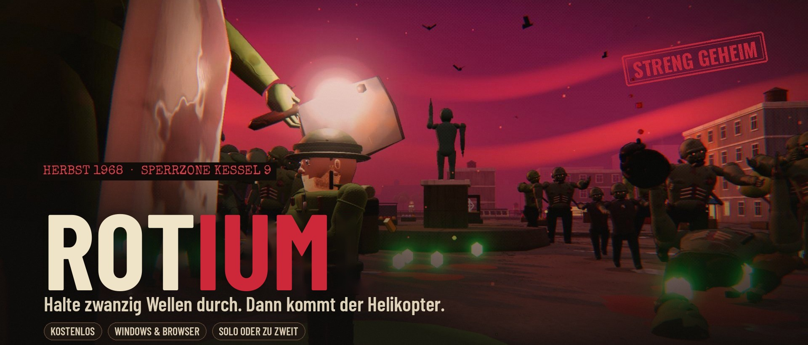</a>

<p align="center">
  <a href="https://beydo7.github.io/rotium-releases/release/"></a>&nbsp;&nbsp;
  <a href="https://beydo7.github.io/rotium-releases/play/"></a>
</p>

<p align="center">
  <a href="https://github.com/beydo7/rotium-releases/releases/latest"></a>
  <a href="https://github.com/beydo7/rotium-releases/releases"></a>
  <a href="https://discord.gg/6yuVzSg8vg"></a>
  <a href="https://tiktok.com/@beydyoyo"></a>
</p>

<p align="center"><sub>🔁 <b>ROTIUM hieß bis November 2026 ROTFALL.</b> Gleiches Spiel, neuer Name – dein Fortschritt kommt automatisch mit.</sub></p>

<br>

<p align="center"></p>

<p align="center"></p>

<p align="center">
  <a href="#akte-01">📁 Das Spiel</a> &nbsp;·&nbsp;
  <a href="#akte-02">🧰 Was dich erwartet</a> &nbsp;·&nbsp;
  <a href="#akte-03">🎖️ Figuren</a> &nbsp;·&nbsp;
  <a href="#akte-04">🗺️ Einsatzgebiete</a> &nbsp;·&nbsp;
  <a href="#akte-05">✨ Neue Engine</a> &nbsp;·&nbsp;
  <a href="#akte-06">▶️ Spielen</a> &nbsp;·&nbsp;
  <a href="#akte-07">🎮 Steuerung</a> &nbsp;·&nbsp;
  <a href="#akte-08">❓ FAQ</a> &nbsp;·&nbsp;
  <a href="#akte-09">📓 Tagebuch</a>
</p>

<details>
<summary>🇬🇧 <b>English summary</b></summary>
<br>

**ROTIUM** is a free 3D zombie survival roguelite set in the Cold War, autumn 1968. Think *Megabonk* meets the zombie mode of *Call of Duty*: your weapons fire on their own – you run, dodge, loot, upgrade and make the calls. Survive 20 waves, power up the generators, forge your weapons, then hold the landing zone until the helicopter arrives. And whatever you do: listen to Echo. Mostly.

- **25 characters** – from a sergeant to a radioactive raccoon, a knitting grandma and a five-star chicken general
- **31 weapons**, each with 5 levels, forging and its own evolution
- **7 maps** plus a final level with three endings, daily orders, threat levels and a camp to upgrade
- Online **co-op** for two via Steam (Windows), controller support, 8 languages

[Download for Windows](https://beydo7.github.io/rotium-releases/release/) · [Play in your browser](https://beydo7.github.io/rotium-releases/play/) · Language: **Options → Display → „Sprache · Language“**
</details>

<p align="center"></p>

<a id="akte-01"></a>

> **Herbst 1968.** Ein Meteorit schlägt in den Bergen nahe der Forschungsstation **Kessel 9** ein. Das Gestein glüht rot, die Forscher nennen es **Rotium** – und es lässt Tote wieder aufstehen.
>
> Drei Wochen später bricht die Eindämmung zusammen. Die Station meldet sich nicht mehr. Dann knackt dein Funkgerät, und eine ruhige Stimme stellt sich als **Echo** vor. Echo gibt dir Befehle. Echo bietet dir Pakte an. Echo weiß erstaunlich viel über Projekt ███████.
>
> Die Frage ist nicht, ob du ihr vertraust. Die Frage ist, wie lange noch.

<details>
<summary>🔓 <i>Geschwärzte Stelle aufdecken</i></summary>
<br>

Projekt **ROTIUM**. Leitung: ████████████. Status: *versiegelt – Ebene 9*.<br>
<sub>Nett versucht. Manche Akten öffnen sich nur im Spiel.</sub>
</details>

<br>

<p align="center">
  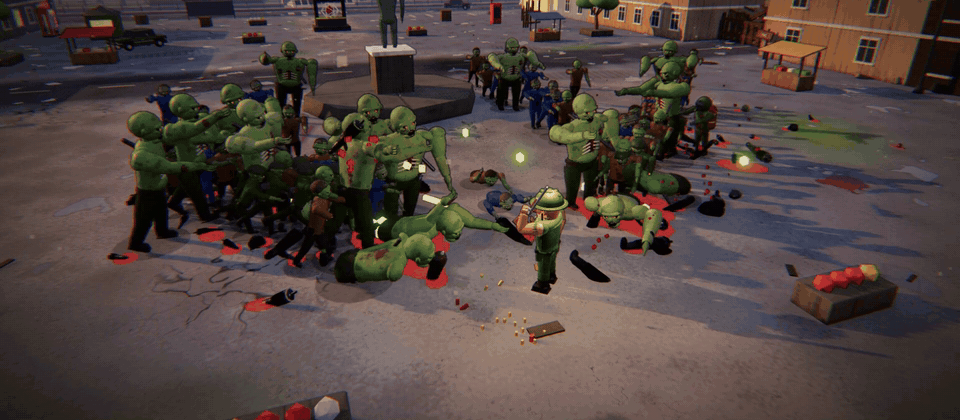
  <br><sub><i>Grauheim, Marktplatz, Welle 14. Niemand ist zum Einkaufen hier.</i></sub>
</p>

Deine Waffen feuern **von selbst**. Du kümmerst dich ums Überleben: laufen, springen, ausweichen, Beute einsammeln – und nach jeder Beförderung eine Entscheidung treffen, die den ganzen Einsatz verändert. Räum Trümmer weg, öffne neue Gebiete, bring die Generatoren ans Netz. Nach Welle 20 kommt der Helikopter. **Einsteigen – oder bleiben?**

<p align="center"></p>

<a id="akte-02"></a>

<table>
<tr>
<td width="55%">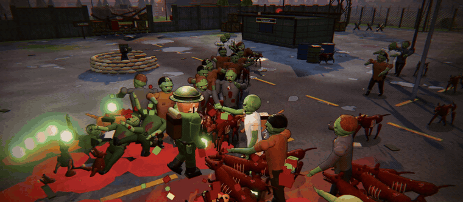</td>
<td width="45%" valign="middle">

### 🧟 Eine Horde, die lebt
Hunderte Zombies gleichzeitig – und jeder läuft anders. Sie humpeln, kriechen ohne Beine weiter, verkohlen im Feuer und zerspringen im Frost. **19 Arten**, Bosse, Rudel aus Rotium-Hunden und auf jeder Karte ein eigener Bewohner, der dir dort das Leben schwer macht.
</td>
</tr>
<tr>
<td valign="middle">

### 🔫 Waffen, die wachsen
**31 Waffen** von der Dienstpistole bis zur Schwimmnudel. Jede hat fünf Stufen, lässt sich in der Rotium-Schmiede veredeln – und wird mit dem passenden Upgrade zu etwas völlig Neuem. Aus der Tesla-Spule wird ein **Kettenblitz-Gewitter**. Aus dem Rest wird … probier's aus.
</td>
<td align="center">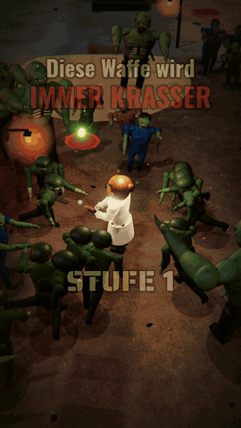</td>
</tr>
<tr>
<td>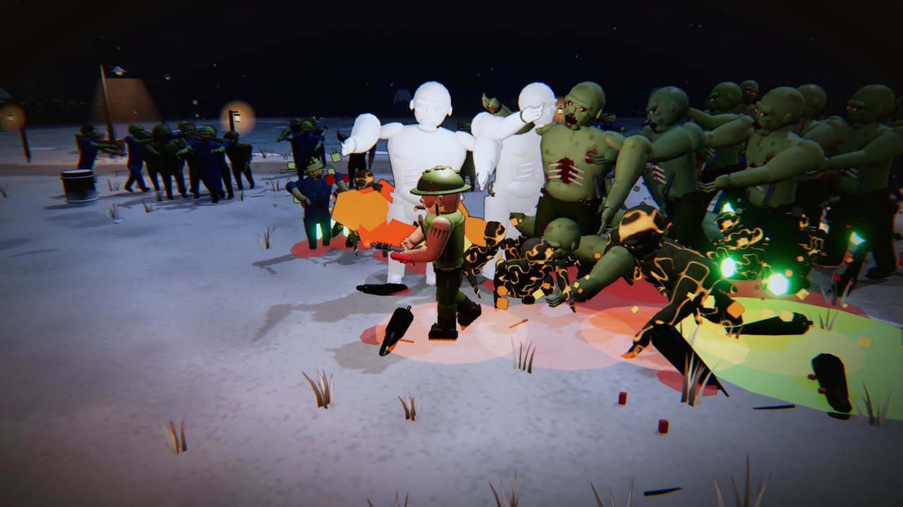</td>
<td valign="middle">

### ⚙️ Die Karte gehört dir
Wie im Zombie-Modus von CoD: **Trümmer räumen**, Gebiete öffnen, **Generatoren** ans Netz bringen. Perk-Automaten, die Wunderkiste, Geschütze, Leuchtfackeln – und auf jeder Karte eine **Stellung mit eigener Falle**, die du verteidigen kannst.
</td>
</tr>
<tr>
<td valign="middle">

### 📻 Echos Befehle & Pakte
Mitten im Kampf meldet sich Echo: *„Halte den Generator.“ „Rette den Überlebenden.“* Wer gehorcht, wird belohnt. Wer einen **Pakt** eingeht, bekommt Macht – und bezahlt dafür. Dazu Ereignisse wie **Stromausfall** oder **Blutmond**.
</td>
<td>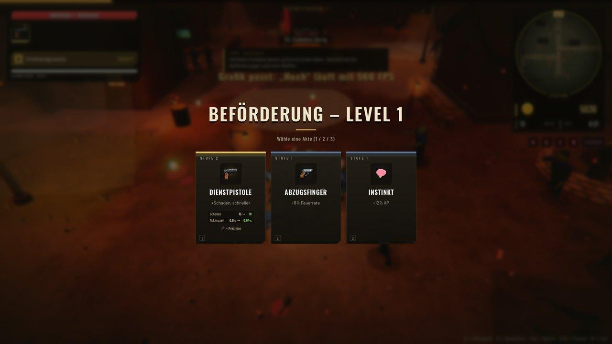</td>
</tr>
<tr>
<td></td>
<td valign="middle">

### 🏕️ Etwas, das bleibt
Rotium-Splitter wandern ins **Lager**: Waffenkammer, Lazarett, Funkraum, Labor. Dazu **Feldakten** über jeden Zombie, ein **Lexikon** im Stil einer Geheimakte, **40 Auszeichnungen** und ein **Tagesbefehl**, der für alle Spieler gleich ist.
</td>
</tr>
<tr>
<td valign="middle">

### 🚁 Evakuierung & Finale
Halte die Landezone, bis der Helikopter da ist – oder kämpf endlos weiter. Wer auf drei Karten evakuiert, darf hinunter: **Ebene 9**. Dort wartet die Antwort auf die Frage, wer Echo ist. Und **drei Enden**.
</td>
<td>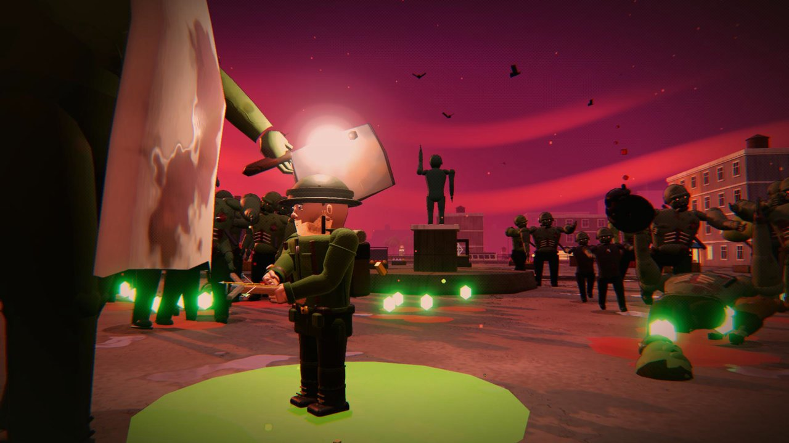</td>
</tr>
</table>

<p align="center"></p>

<a id="akte-03"></a>

<p align="center">
  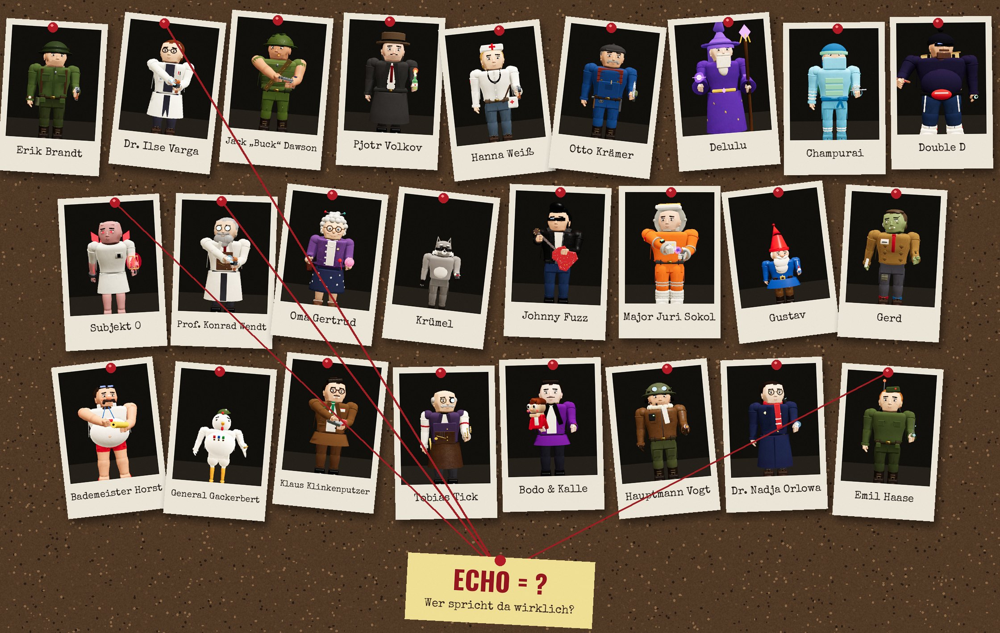
  <br><sub><i>Die Ermittlungswand. Irgendjemand hier weiß mehr, als er sagt.</i></sub>
</p>

Jede Figur hat eine eigene **Startwaffe**, eigene Stärken und Schwächen, eine **Spezialfähigkeit** und ihre eigene Art zu laufen. Und bleibst du kurz stehen, merkt man, wer sie sind: Volkov zündet sich eine an, Johnny stimmt die Gitarre, Tick schaut auf die Uhr, Krümel knabbert an irgendwas.

<table>
<tr>
<td align="center" width="34%">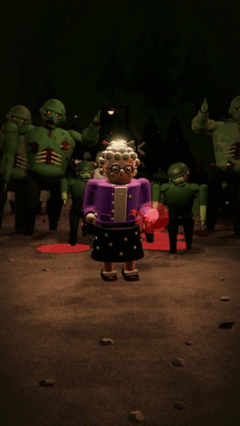</td>
<td width="66%" valign="middle">

> *„Ich wohne seit 1921 in Kessel 9. Da lasse ich mich doch von so ein paar Toten nicht vertreiben.“*
> <br>— **Oma Gertrud**, Wollknäuel-Werferin

Niemand rechnet mit ihr. Ihre Wolle fesselt ganze Gruppen, ihr Kuchen lockt die Horde weg, und statt auszuweichen schlägt sie mit der Handtasche zu.

**Und dann wären da noch:** Krümel, der Rotium-Waschbär, der alles klaut · General Gackerbert, das einzige Huhn, das den Einschlag überlebt hat · Bademeister Horst (*„Alle raus aus dem Becken!“*) · Bodo & Kalle – wer von beiden spricht hier eigentlich?
</td>
</tr>
</table>

<p align="center">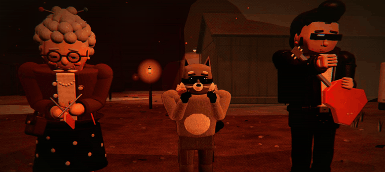</p>

<details>
<summary>📂 <b>Alle 25 Personalakten</b> <sub>(Fähigkeit und wie man sie freischaltet)</sub></summary>
<br>

| Figur | Wer ist das? | Fähigkeit | Freischalten |
|---|---|---|---|
| **Erik Brandt** | Feldwebel, kennt jeden Winkel von Kessel 9 | Stielhandgranate | von Anfang an |
| **Dr. Ilse Varga** | Rotium-Forscherin, weiß mehr, als sie sagt | Tesla-Entladung | von Anfang an |
| **Pjotr Volkov** | KGB-Agent, offiziell Übersetzer | Rauchgranate | von Anfang an |
| **Champurai** | Der letzte Ninja aus LuckyTown | Rauchschleier | 500 Splitter |
| **Krümel** | Rotium-Waschbär, klaut alles | Mülltonne | 750 Splitter |
| **Johnny Fuzz** | Rock’n’Roll-Gitarrist der Truppenbetreuung | Gitarrensolo | 1000 Splitter |
| **Double D** | Meister der Nacht, Vape in der Hand | Chaosnova | 1250 Splitter |
| **Delulu** | Magier aus einer anderen Welt | Frostnova | 1500 Splitter |
| **Jack „Buck“ Dawson** | US-Marine, laut, stur, unkaputtbar | Sturmangriff | Auszeichnung |
| **Hanna Weiß** | Sanitäterin, hat aufgehört zu zählen | Adrenalinspritze | Auszeichnung |
| **Otto Krämer** | Hausmeister, repariert alles | Bastel-Minen | Auszeichnung |
| **Subjekt 0** | Das erste Testsubjekt. Er erinnert sich an Echo. | Rotium-Ausbruch | Auszeichnung |
| **Oma Gertrud** | Wohnt seit 1921 in Kessel 9 | Frisch gebacken | Auszeichnung |
| **Major Juri Sokol** | Kosmonaut, seine Kapsel ging 1968 verloren | Raketenrucksack | Auszeichnung |
| **Gustav** | Gartenzwerg mit Laser-Augen | Zipfelmützen-Armee | Auszeichnung |
| **Gerd** | Der nette Zombie. Hat noch Manieren. | Einer von euch | Auszeichnung |
| **Bademeister Horst** | Seit dem Einschlag ist Badeschluss. Für immer. | Alle raus aus dem Becken! | Auszeichnung |
| **General Gackerbert** | Das einzige Huhn, das den Einschlag überlebt hat | Federsturm | Auszeichnung |
| **Klaus Klinkenputzer** | Staubsaugervertreter, seit 1968 von Tür zu Tür | Vorführung | Auszeichnung |
| **Tobias Tick** | Uhrmacher. Seine Taschenuhr tickt noch. | Zeit anhalten | Auszeichnung |
| **Bodo & Kalle** | Bauchredner und Puppe | Kalle wird frech | Auszeichnung |
| **Hauptmann Vogt** | Helikopterpilot, diesmal selbst abgestürzt | Tiefflug | Auszeichnung |
| **Dr. Nadja Orlowa** | Astronomin, hat den Meteoriten zuerst gesehen | Meteorschauer | Auszeichnung |
| **Emil Haase** | Funker von Kessel 9, hörte Echo als Erster | Luftunterstützung | Auszeichnung |
| **Prof. Konrad Wendt** | ███████ | Rotium-Schlag | ein Geheimnis auf Ebene 9 |

<sub>Welche Auszeichnung welche Figur freischaltet, steht im Spiel unter <b>Auszeichnungen</b>.</sub>
</details>

<p align="center"></p>

<a id="akte-04"></a>

Jede Karte hat ihren eigenen Grundriss, ihr eigenes Wetter, ihren eigenen Zombie – und **eine Besonderheit**, die dich zwingt, anders zu spielen.

<table>
<tr>
<td width="50%">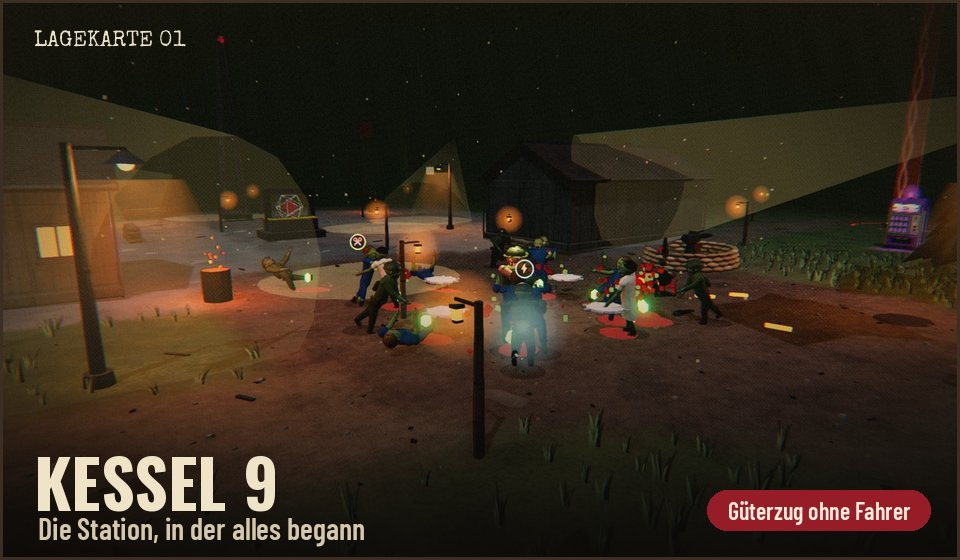<br><sub>Ein Güterzug ohne Fahrer donnert regelmäßig durchs Tal. Zombies auf dem Gleis haben Pech. <b>Du auch.</b></sub></td>
<td width="50%">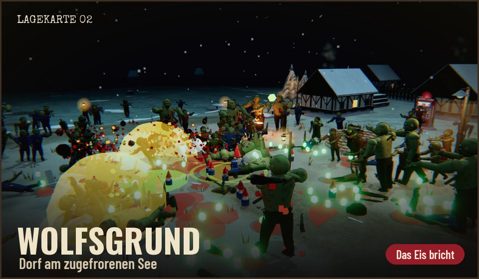<br><sub>Der See ist zugefroren. Explosionen sehen das anders – wer einbricht, wird langsam und friert.</sub></td>
</tr>
<tr>
<td>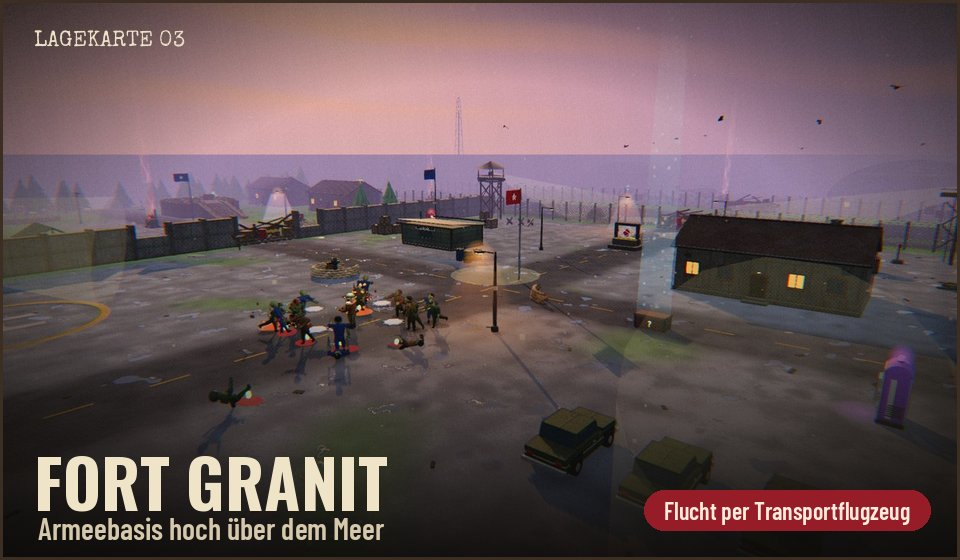<br><sub>Startbahn quer übers Plateau, Hangars im Norden. Hier holt dich ein Transportflugzeug ab.</sub></td>
<td>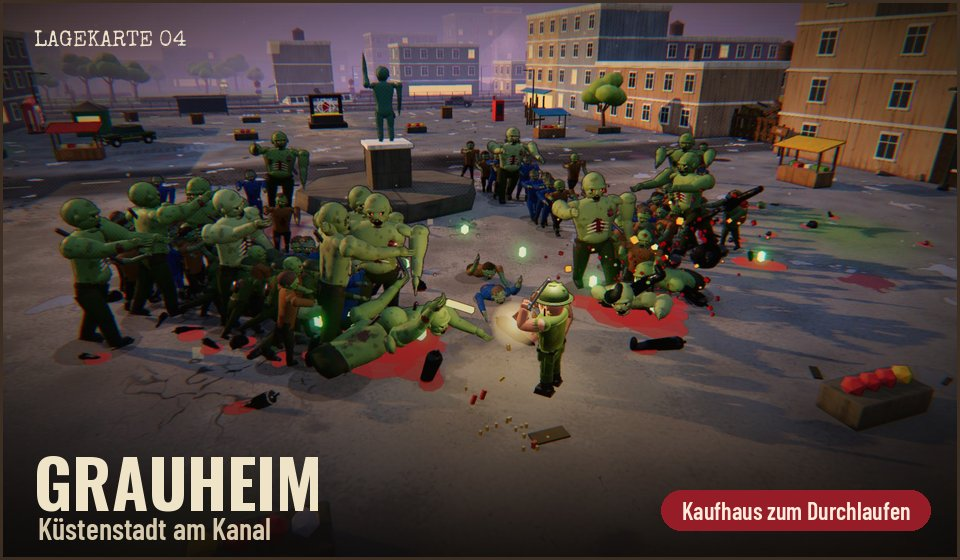<br><sub>Ein Kanal teilt die Stadt. Brücken, Kino, Hotel – und ein Kaufhaus, durch das du mitten durch rennst.</sub></td>
</tr>
<tr>
<td>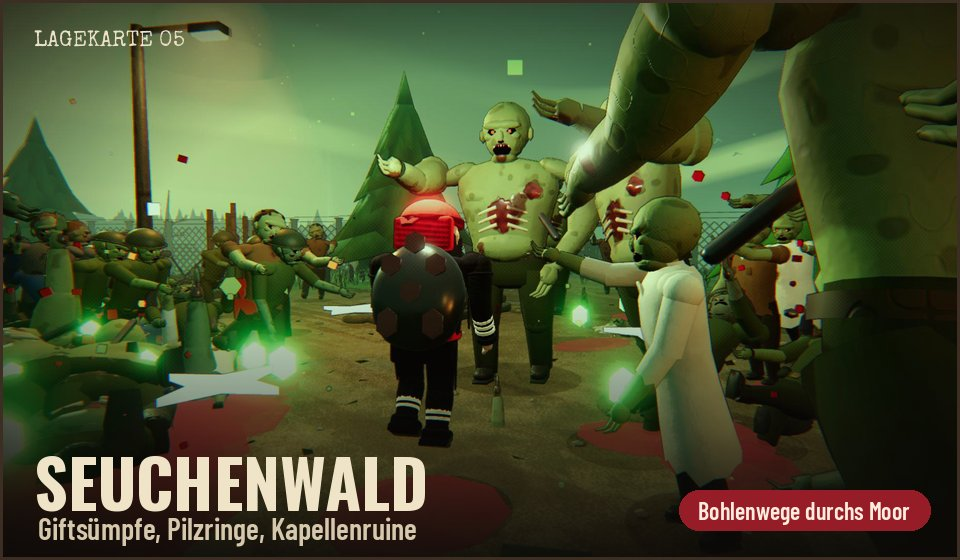<br><sub>Giftsümpfe, Pilzringe, eine Kapellenruine. Auf den Bohlenwegen bist du sicher. Meistens.</sub></td>
<td>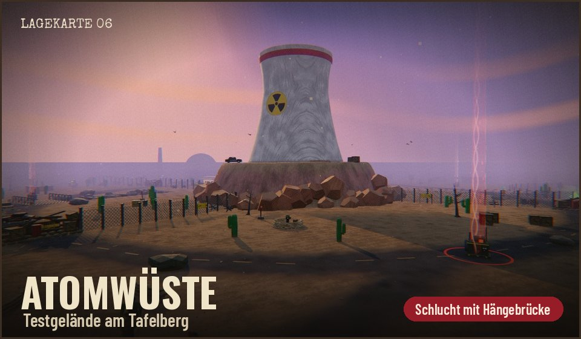<br><sub>Testgelände rund um den Tafelberg. Über die Hängebrücke – oder außen herum?</sub></td>
</tr>
</table>

<p align="center">
  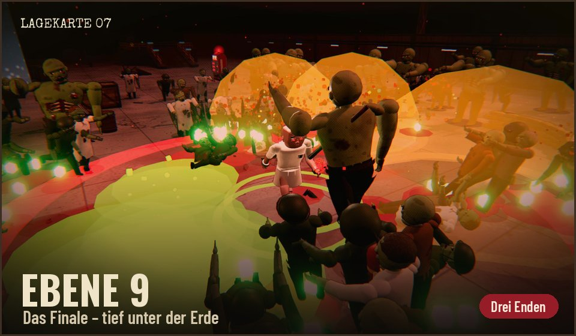
  <br><sub>Evakuiere auf drei Karten. Dann fährt der Aufzug nach unten.</sub>
</p>

<p align="center"></p>

<a id="akte-05"></a>

<p align="center">
  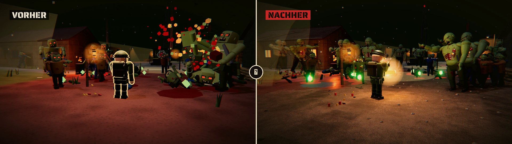
  <br><sub><b>Links</b> die alte Version, <b>rechts</b> dieselbe Stelle heute.</sub>
</p>

Mit **v3.0** ist ROTIUM komplett auf die **Godot-Engine** umgezogen – jede Figur, jede Waffe, jede Karte, jeder Knopf. Das Ergebnis:

- 🎨 **Detailliertere Welt:** Figuren mit weicheren Formen, Zombies mit Rippen und Adern, Karten mit Boden-Mischung, Gras, Streu-Deko und echtem Wasser
- 💡 **Echtes Licht:** Laternen, Suchscheinwerfer, Glühen bei Explosionen, Schatten
- 🤝 **Koop über Steam:** Raum-Code eingeben oder Freund einladen – keine IP-Adressen mehr
- 🗺️ **Karten voller Leben:** Bodenspuren, Bodennebel, Zerstörbares, Abkürzungen und eigene Mechaniken je Karte
- 💾 **Dein Fortschritt kommt mit:** Figuren, Splitter, Auszeichnungen aus der alten Version werden beim ersten Start übernommen

<p align="center"></p>

<a id="akte-06"></a>

<table>
<tr>
<td align="center" width="33%">

### 🪟 Windows
**Empfohlen.** Volle Grafik, Koop.<br><br>
<a href="https://beydo7.github.io/rotium-releases/release/"></a>
<br><sub>ZIP laden · entpacken · <code>ROTIUM.exe</code></sub>
</td>
<td align="center" width="33%">

### 🌐 Browser
Ohne Download, sofort los.<br><br>
<a href="https://beydo7.github.io/rotium-releases/play/"></a>
<br><sub>Am besten in Chrome oder Edge</sub>
</td>
<td align="center" width="33%">

### 🧪 Playtest
Das nächste Update vorab.<br><br>
<a href="https://beydo7.github.io/rotium-releases/test/"><b>Testversion öffnen →</b></a>
<br><br><sub>Kann Fehler enthalten – genau dafür ist sie da</sub>
</td>
</tr>
</table>

> [!TIP]
> Warnt Windows mit *„Der Computer wurde durch Windows geschützt“*? **„Weitere Informationen“ → „Trotzdem ausführen“.** Das Spiel ist nur noch nicht signiert. Dein Fortschritt bleibt bei jedem Update erhalten.

**Läuft das auf meinem PC?** Im Spiel unter **Optionen → Grafik → „Leistungstest starten“** misst ROTIUM in etwa sechs Minuten, wie gut es läuft. Schick dein Ergebnis gern in den [Discord](https://discord.gg/6yuVzSg8vg) – daraus entstehen gerade die offiziellen Systemanforderungen.

<p align="center"></p>

<a id="akte-07"></a>

<div align="center">

| Aktion | Tastatur & Maus | Controller |
|---|:-:|:-:|
| Laufen · Kamera | <kbd>W</kbd> <kbd>A</kbd> <kbd>S</kbd> <kbd>D</kbd> · Maus | linker · rechter Stick |
| Springen | <kbd>Leertaste</kbd> | <kbd>A</kbd> / <kbd>✕</kbd> |
| Ausweichen | <kbd>Shift</kbd> | <kbd>B</kbd> / <kbd>◯</kbd> |
| Benutzen · nächste Welle | <kbd>E</kbd> | <kbd>X</kbd> / <kbd>▢</kbd> |
| Spezialfähigkeit | <kbd>Q</kbd> / Rechtsklick | <kbd>Y</kbd> / <kbd>△</kbd> |
| Upgrade wählen | <kbd>1</kbd> <kbd>2</kbd> <kbd>3</kbd> | Steuerkreuz + <kbd>A</kbd> |
| Werte-Übersicht (halten) | <kbd>Tab</kbd> | <kbd>L3</kbd> |
| Pause | <kbd>Esc</kbd> | <kbd>Start</kbd> |
| Vollbild · Fehlerbericht kopieren | <kbd>F11</kbd> · <kbd>F8</kbd> | |

<sub>Jede Taste lässt sich unter <b>Optionen → Tastenbelegung</b> ändern.</sub>

</div>

<p align="center"></p>

<a id="akte-08"></a>

<details>
<summary><b>Was kostet das Spiel?</b></summary>
<br>

Nichts. ROTIUM ist während der Entwicklung kostenlos – als Windows-Version und im Browser. Keine Anmeldung, keine Werbung, keine Haken.
</details>

<details>
<summary><b>Wie spiele ich mit einem Freund?</b></summary>
<br>

In der Windows-Version mit gestartetem Steam: Hauptmenü → **Koop**. Einer erstellt einen Raum und schickt den **Raum-Code** (oder lädt direkt über Steam ein), der andere tritt bei. Ihr teilt euch Horde, Generatoren und Evakuierung – Waffen, Beförderungen und Schrott hat jeder für sich. Geht einer zu Boden, hilft der andere ihm auf.
</details>

<details>
<summary><b>Behalte ich meinen Fortschritt?</b></summary>
<br>

Ja. Bei Updates sowieso – und beim ersten Start der Godot-Version holt sich ROTIUM automatisch alles aus der alten Version: Figuren, Skins, Splitter, Auszeichnungen, Lager und Rekorde.
</details>

<details>
<summary><b>Gibt es das Spiel auf Englisch?</b></summary>
<br>

Ja, und in sechs weiteren Sprachen: **Deutsch · English · Español · Français · Português (BR) · Русский · 简体中文 · 日本語**. Umstellen unter **Optionen → Anzeige → „Sprache · Language“**.
</details>

<details>
<summary><b>Kommt ROTIUM auf Steam?</b></summary>
<br>

Das ist das große Ziel. Bis dahin wird hier jede neue Version zuerst getestet – von euch.
</details>

<details>
<summary><b>Ich habe einen Fehler gefunden oder eine Idee.</b></summary>
<br>

Super! Im Spiel **F8** drücken – das kopiert einen Fehlerbericht in die Zwischenablage. Dann hier ein [Issue anlegen](https://github.com/beydo7/rotium-releases/issues/new/choose) (Vorlagen „Fehler“ und „Idee“) oder im [Discord](https://discord.gg/6yuVzSg8vg) melden. Jede Meldung wird gelesen.
</details>

<p align="center"></p>

<a id="akte-09"></a>

> ROTIUM ist mein Hobbyprojekt. Angefangen hat es mit einer einfachen Frage: *Wie würde sich Megabonk anfühlen, wenn man es mit den Zombie-Karten aus Call of Duty kreuzt – und alles im Kalten Krieg spielt?*
>
> Seitdem wächst das Spiel jeden Tag, gebaut zusammen mit KI und getestet von Freunden, die mir nach jeder Runde sagen, was nervt und was Spaß macht. Ohne euch wäre ROTIUM nicht das, was es heute ist. **Danke fürs Spielen.** 🖤
>
> — *Pascal*

<p align="center"></p>

<details>
<summary>📻 <i>Kanal 9 – nur für Befugte</i></summary>
<br>

```
[03:14] ECHO   … bist du noch da?
[03:14] ECHO   Gut. Dann hör genau zu.
[03:15] ECHO   Auf jeder Karte steht ein Gartenzwerg, wo keiner stehen sollte.
[03:15] ECHO   Sieben Stück. Finde sie alle, und einer von ihnen kommt mit dir.
[03:16] ECHO   Und falls dir ein Zombie mit Namensschild begegnet …
[03:16] ECHO   … lass ihn leben. Er heißt Gerd. Er ist nett.
[03:17] ----   VERBINDUNG GETRENNT
```
</details>

<br>

<p align="center"></p>

<p align="center">
  <a href="https://github.com/beydo7/rotium-releases/issues/new?template=1-fehler.yml"></a>&nbsp;
  <a href="https://github.com/beydo7/rotium-releases/issues/new?template=2-idee.yml"></a>&nbsp;
  <a href="https://discord.gg/6yuVzSg8vg"></a>
</p>

<p align="center"><sub>Mit 🖤 und viel Rotium gebaut · ROTIUM ist ein Hobbyprojekt von Pascal</sub></p>
