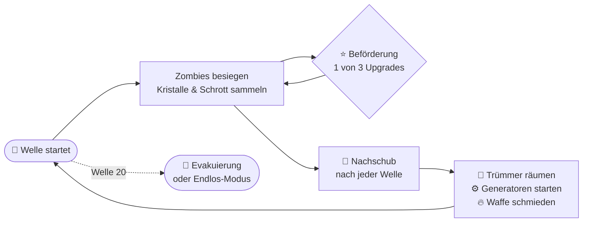
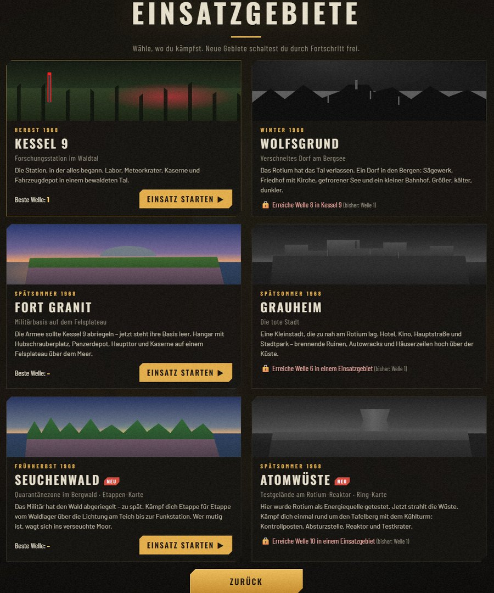

  

  

  
  
  
  
  

  &nbsp;&nbsp;
  

<b>Kostenlos</b> &nbsp;·&nbsp; keine Anmeldung &nbsp;·&nbsp; dein Fortschritt bleibt bei Updates erhalten

 

> [!CAUTION]
> **VERSCHLUSSSACHE · PROJEKT ROTFALL · NUR FÜR DEN DIENSTGEBRAUCH**

**Herbst 1968.** Ein Meteorit schlägt in den Bergen nahe der geheimen Forschungsstation **Kessel 9** ein. Die Wissenschaftler nennen das rot glühende Gestein **Rotium**. Es lässt Tote wieder aufstehen.

Drei Wochen später bricht die Eindämmung zusammen. Die Tore sind verriegelt, der Strom ist weg. Dann knackt das alte Funkgerät am Sendemast, und eine Stimme meldet sich, die sich **Echo** nennt.

Woher Echo das alles weiß? Darüber denkst du später nach. **Jetzt kommen sie.**

  
   <i>Erste Welle im Waldlager. Deine Waffen feuern von allein, du hältst die Horde auf Abstand.</i>

**ROTFALL** ist ein 3D-Survival-Roguelite mit Zombies, angelehnt an Spiele wie *Megabonk* und den Zombie-Modus aus *Call of Duty*. Deine Waffen feuern **automatisch**, du konzentrierst dich aufs Überleben: ausweichen, Beute einsammeln, aufrüsten, Entscheidungen treffen. Jede Welle bringt mehr Zombies, jede Beförderung macht dich stärker, und jeder Einsatz läuft anders.

 

<table>
<tr>
<td width="50%" valign="top">

### 🔫 17 Waffen
Von der Dienstpistole bis zur Tesla-Spule. Jede ist in **5 Stufen** aufrüstbar und lässt sich einmal in der **Rotium-Schmiede veredeln**, mit eigenem Namen und rotem Glühen.

</td>
<td width="50%" valign="top">

### 📻 Echos Befehle
Mitten im Kampf funkt Echo Aufträge: Funkcode bergen, Stellung halten, Sprengsatz entschärfen. Schaffst du es nicht rechtzeitig, löscht ein Rotium-Schlag alles aus. Auch dich.

</td>
</tr>
<tr>
<td valign="top">

### ⚙️ Generatoren & Schmiede
Bring vier Generatoren ans Netz, dann startet die Schmiede im Zentrum. Aber die Toten greifen laufende Generatoren an.

</td>
<td valign="top">

### 🎲 Wunderkiste & Perks
Zufällige Waffen aus der Kiste, Perks aus den Automaten: Zweite Chance, Doppelabzug, Schnellhand-Serum und mehr.

</td>
</tr>
<tr>
<td valign="top">

### 🩸 Echos Pakte
Echo bietet dir Macht an, aber jeder Pakt hat seinen Preis. Doppelter Schrott, dafür weniger Heilung? Du entscheidest.

</td>
<td valign="top">

### 🆘 Überlebende retten
Befreie Gefangene aus Käfigen. Soldaten kämpfen an deiner Seite, Wissenschaftler halten Generatoren am Laufen.

</td>
</tr>
<tr>
<td valign="top">

### 🧬 Zombie-Eigenschaften
Brennend, gepanzert, spaltend, regenerierend … Ab Welle 6 halten die Toten Überraschungen bereit.

</td>
<td valign="top">

### 🌧️ Jede Nacht anders
Wetter, Wäldchen und Deckung werden bei jedem Einsatz neu gewürfelt. Kein Durchgang gleicht dem anderen.

</td>
</tr>
</table>

<b>🔁 So läuft ein Einsatz ab</b> (aufklappen)

 

 

<table>
<tr>
<td width="50%"></td>
<td width="50%"></td>
</tr>
<tr>
<td valign="top">Die Station, in der alles begann. Laborkomplex, Meteorkrater mit Hubschrauberwrack, Kaserne und Fahrzeugdepot in einem bewaldeten Tal.</td>
<td valign="top">Sägewerk, Kirche mit Friedhof, ein gefrorener See und ein kleiner Bahnhof. Größer, kälter, dunkler. Die Glocke läutet nachts von allein.</td>
</tr>
<tr>
<td></td>
<td></td>
</tr>
<tr>
<td valign="top">Die verlassene Armeebasis auf einem Felsplateau über dem Meer: Hangar mit Hubschraubern, Panzerdepot, Haupttor und Kaserne.</td>
<td valign="top">Grand Hotel mit Leuchtschrift, Kino, Tankstelle, Stadtpark und ein verbarrikadierter Marktplatz. Brennende Ruinen hoch über der Küste.</td>
</tr>
<tr>
<td></td>
<td></td>
</tr>
<tr>
<td valign="top"><b>Etappen-Karte:</b> Vom Waldlager über die Lichtung bis zur Funkstation kämpfst du dich Stück für Stück vor. Oder du wagst dich ins giftige Moor.</td>
<td valign="top"><b>Ring-Karte</b> um einen Tafelberg mit Kühlturm. Sind alle Tore offen, läufst du einmal im Kreis, die Horde immer hinter dir.</td>
</tr>
</table>

 

  

Zehn Charaktere, jeder mit eigener Startwaffe, eigenen Werten und einer **Spezialfähigkeit** (<kbd>Q</kbd>). Mit jedem Einsatz steigt ihre **Meisterschaft**: zehn Ränge mit Titeln, Skins und einer zweiten Startwaffe.

| | Charakter | Wer ist das? | Fähigkeit |
|:-:|---|---|---|
| 🎖️ | **Erik Brandt** | Feldwebel, kennt jeden Winkel von Kessel 9 | 💣 Stielhandgranate |
| 🔬 | **Dr. Ilse Varga** | Rotium-Forscherin, weiß mehr, als sie sagt | ⚡ Tesla-Entladung |
| 🇺🇸 | **Jack „Buck“ Dawson** | US-Marine, laut, stur, unkaputtbar | 🐂 Sturmangriff |
| 🕵️ | **Pjotr Volkov** | KGB-Agent, offiziell Übersetzer | 💨 Rauchgranate |
| ⛑️ | **Hanna Weiß** | Sanitäterin, hat aufgehört zu zählen | 💉 Adrenalinspritze |
| 🔧 | **Otto Krämer** | Hausmeister, repariert alles | 🧨 Bastel-Minen |
| ☢️ | **Subjekt 0** | Das erste Testsubjekt. Er erinnert sich an Echo. | 🔴 Rotium-Ausbruch |
| 🧙 | **Delulu** | Magier aus einer anderen Welt | ❄️ Frostnova |
| 🥷 | **Champurai** | Der letzte Ninja aus LuckyTown | 🌫️ Rauchschleier |
| 🕶️ | **Double D** | Meister der Nacht. Hasst Zombies. Vape in der Hand. | 🌀 Chaosnova |

 

Schlurfer, Renner und Rotköter sind erst der Anfang.

- 💥 **Bomber** explodieren
- 🎯 **Schützen** zielen mit rotem Strahl
- 🧪 **Spucker** werfen Säure
- 🕳️ **Gräber** tauchen direkt neben dir auf
- 📢 **Kreischer** machen alle anderen wild

Dann sind da noch **der Schlachter**, **Oberst Krüger** und *er*: **der Erstgeborene**.

Alles, was du über sie herausfindest, landet in den **Feldakten**, mit Echos ganz persönlichen Notizen.

 
 

  

Im **Lexikon** im Hauptmenü findest du jede Waffe mit allen Werten pro Stufe, dazu Perks, Power-Ups, Pakte und alles Wissenswerte über Kessel 9.

<b>📸 Weitere Bilder</b> (Hauptmenü, Lexikon, Einsatzgebiete, Akte)

 

    
    
  
  

 

  &nbsp;&nbsp;
  

Auf der [Download-Seite](https://github.com/beydo7/rotfall-releases/releases/latest) findest du ganz unten bei **Assets**:

| Datei | |
|---|---|
| 🖥️ `ROTFALL-…-Windows.zip` | **Empfohlen.** Eigenes Programm mit `ROTFALL.exe` |
| 🌐 `ROTFALL-…-Browser.zip` | Läuft in Chrome oder Edge, ohne Installation |

**Windows in 3 Schritten**
1. `ROTFALL-…-Windows.zip` herunterladen
2. Rechtsklick → **„Alle extrahieren“**
3. **`ROTFALL.exe`** starten

> [!NOTE]
> Warnt Windows mit *„Der Computer wurde durch Windows geschützt“*? Dann auf **„Weitere Informationen“ → „Trotzdem ausführen“** klicken. Das Spiel ist einfach noch nicht signiert.

> [!TIP]
> **Update?** Neue Zip herunterladen, entpacken, fertig. Dein Fortschritt bleibt erhalten.
> Im Browser gespeicherter Fortschritt ist getrennt von der Windows-Version.

 

| Taste | Aktion | | Taste | Aktion |
|:-:|---|---|:-:|---|
| <kbd>W</kbd> <kbd>A</kbd> <kbd>S</kbd> <kbd>D</kbd> | Laufen | | <kbd>E</kbd> | Benutzen (Trümmer, Automaten, Kiste …) |
| 🖱️ Maus | Kamera drehen | | <kbd>1</kbd> <kbd>2</kbd> <kbd>3</kbd> | Upgrade wählen |
| <kbd>Leertaste</kbd> | Springen | | 🖱️ Mausrad | Zoom |
| <kbd>Shift</kbd> | Ausweichen (kurz unverwundbar) | | <kbd>Esc</kbd> | Pause & Optionen |
| <kbd>Q</kbd> / Rechtsklick | Spezialfähigkeit | | <kbd>F11</kbd> | Vollbild |
| | | | <kbd>F8</kbd> | Fehlerbericht kopieren |

 

<b>💻 Läuft das Spiel auf meinem PC?</b>

 

Windows 10 oder 11 (64 Bit) und eine Grafikkarte der letzten Jahre reichen. Ruckelt es, stell unter **Optionen → Grafik** die **Schatten** auf „Mittel“ oder „Aus“.

<b>🌍 Gibt es das Spiel auf Englisch?</b>

 

Ja, und in sechs weiteren Sprachen: **Deutsch · English · Español · Français · Português (BR) · Русский · 简体中文 · 日本語**. Umstellen unter **Optionen → Anzeige → „Sprache · Language“**.

<b>💾 Geht mein Fortschritt beim Update verloren?</b>

 

Nein. Charaktere, Skins, Splitter, Erfolge und Meisterschaft bleiben erhalten.

<b>🐛 Ich habe einen Fehler gefunden oder eine Idee!</b>

 

Super, genau dafür ist der Playtest da! Über die Buttons unten kommst du direkt zum passenden Formular. Ein GitHub-Konto brauchst du dafür (kostenlos).

Bei Fehlern: Drück im Spiel <kbd>F8</kbd>. Das kopiert einen Fehlerbericht in die Zwischenablage, den du einfach ins Formular einfügst. Screenshots (<kbd>Win</kbd> + <kbd>Shift</kbd> + <kbd>S</kbd>) helfen sehr.

Kein GitHub-Konto? Dann schick Pascal den F8-Bericht einfach direkt.

 

  &nbsp;&nbsp;
  

---

  <b>🧪 Playtest-Version.</b> ROTFALL ist mitten in der Entwicklung, alles kann sich noch ändern. 
  Was in jeder Version neu ist, steht bei den <a href="https://github.com/beydo7/rotfall-releases/releases">Releases</a>.

ROTFALL · ein Spiel von Pascal · Alle Rechte vorbehalten

<i>📻 Hör auf Echo. Meistens.</i>

