

  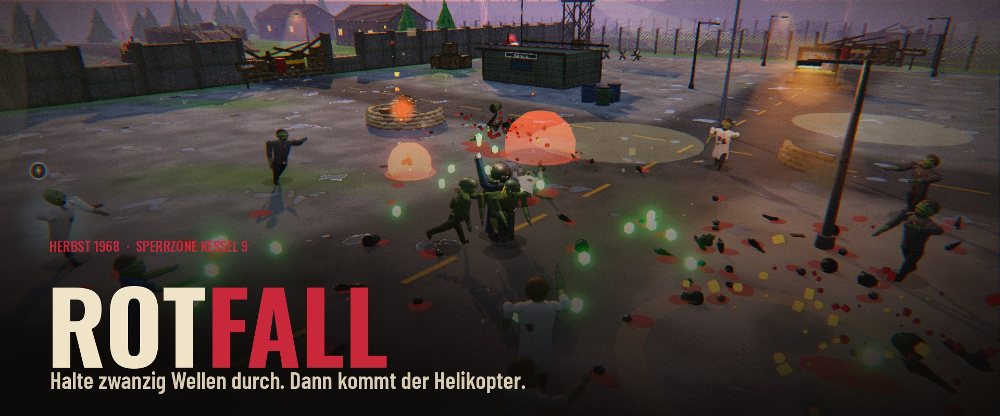

  &nbsp;&nbsp;
  

<b>Kostenlos</b> &nbsp;·&nbsp; keine Anmeldung &nbsp;·&nbsp; Windows &amp; Browser &nbsp;·&nbsp; solo oder zu zweit &nbsp;·&nbsp; 8 Sprachen &nbsp;·&nbsp; Controller

  
  
  
  

  <a href="#spiel">Das Spiel</a> &nbsp;·&nbsp;
  <a href="#features">Features</a> &nbsp;·&nbsp;
  <a href="#figuren">Figuren</a> &nbsp;·&nbsp;
  <a href="#karten">Karten</a> &nbsp;·&nbsp;
  <a href="#download">Download</a> &nbsp;·&nbsp;
  <a href="#steuerung">Steuerung</a> &nbsp;·&nbsp;
  <a href="#faq">FAQ</a>

<b>English summary</b>

 

**ROTFALL** is a free 3D zombie survival roguelite set in the Cold War, autumn 1968. Think *Megabonk* meets the zombie mode of *Call of Duty*: your weapons fire on their own – you run, dodge, loot, upgrade and decide. Survive 20 waves, power up the generators, forge your weapons, then hold the landing zone until the helicopter arrives.

- **25 characters**, each with their own weapon, ability and walk
- **31 weapons**, each with 5 levels, forging and an evolution
- **7 maps** plus a final level with three endings, daily orders, threat levels and a camp to upgrade
- Online **co-op** for two (Windows), controller support, 8 languages

[Download for Windows](https://beydo7.github.io/rotfall-releases/release/) · [Play in your browser](https://beydo7.github.io/rotfall-releases/play/) · Language: **Options → Display → „Sprache · Language“**

 

## Das Spiel

**Herbst 1968.** Ein Meteorit schlägt in den Bergen nahe der geheimen Forschungsstation **Kessel 9** ein. Das rot glühende Gestein nennen sie **Rotium** – und es lässt Tote wieder aufstehen. Drei Wochen später bricht die Eindämmung zusammen. Dann knackt das Funkgerät, und eine Stimme meldet sich: **Echo**. Sie gibt dir Befehle, bietet dir Pakte an und weiß erstaunlich viel.

Deine Waffen feuern **von selbst**. Du kümmerst dich ums Überleben: laufen, springen, ausweichen, Beute sammeln, aufrüsten – und die Karte Stück für Stück erobern. Nach Welle 20 kommt der Helikopter. Einsteigen oder bleiben?

  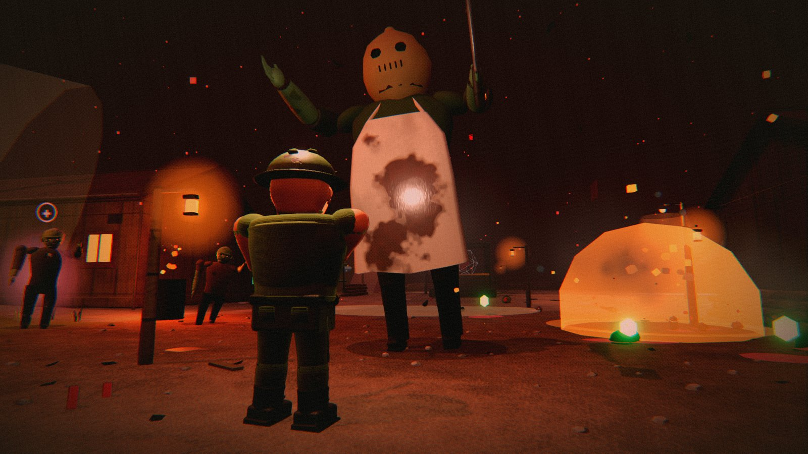

> [!NOTE]
> **Neu: ROTFALL läuft jetzt auf der Godot-Engine.** Detailliertere Figuren, Zombies und Welten, echtes Licht und Schatten, weichere Animationen und mehr Leistung bei großen Horden. Alles, was du kennst, ist dabei – nur schöner.

 

## Features

<table>
<tr>
<td width="50%" valign="top">

**🧟 Eine Horde, die lebt**  
Hunderte Zombies gleichzeitig. Sie humpeln, kriechen ohne Beine weiter, verkohlen im Feuer und zerspringen im Frost. 19 Zombie-Arten – Bosse und ein eigener Zombie je Karte inklusive.

**🔫 31 Waffen, 31 Weiterentwicklungen**  
Von der Dienstpistole bis zur Schwimmnudel. Fünf Stufen, Veredelung in der Rotium-Schmiede – und mit dem passenden Upgrade eine Weiterentwicklung, die sich komplett anders spielt.

**⚙️ Die Karte gehört dir**  
Wie im CoD-Zombie-Modus: Trümmer räumen, Gebiete öffnen, Generatoren ans Netz bringen, Perk-Automaten, Wunderkiste, Geschütze – und je Karte eine Stellung mit eigener Falle.

</td>
<td width="50%" valign="top">

**📻 Echos Befehle & Pakte**  
Aufträge mitten im Kampf, Macht gegen einen Preis, dazu Ereignisse wie Stromausfall oder Blutmond.

**🏕️ Lager, Ränge & Auszeichnungen**  
Rotium-Splitter in dauerhafte Boni stecken, Figuren meistern, 40 Auszeichnungen sammeln.

**📅 Tagesbefehl & Bedrohungsstufen**  
Jeden Tag ein Einsatz für alle gleich. Nach dem ersten Sieg zehn Stufen mit zäherer Horde und mehr Beute.

**🚁 Evakuierung & Finale**  
Halte die Landezone, steig ein – oder kämpf endlos weiter. Ganz unten wartet Ebene 9 mit drei Enden.

</td>
</tr>
</table>

<table>
<tr>
<td width="50%"></td>
<td width="50%">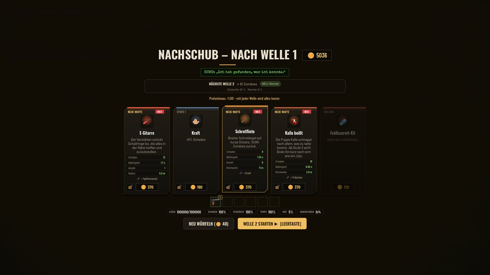</td>
</tr>
<tr>
<td width="50%">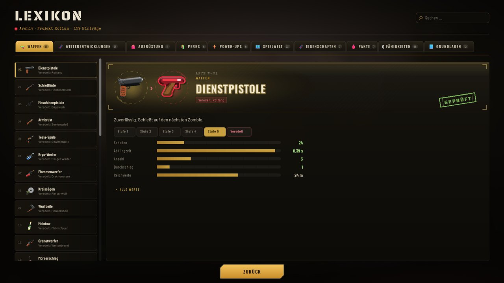</td>
<td width="50%">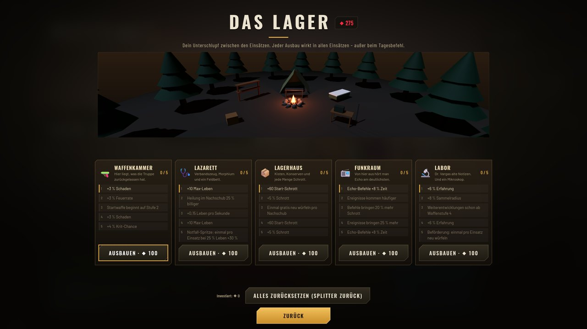</td>
</tr>
</table>

 

## 25 Figuren

  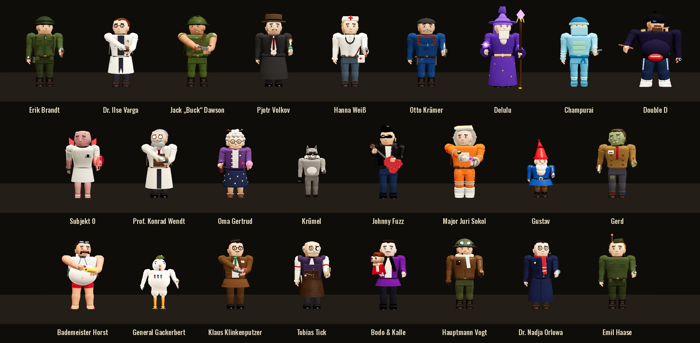

Jede Figur hat eine eigene **Startwaffe**, eigene Werte, eine **Spezialfähigkeit** (<kbd>Q</kbd>) und ihre eigene Art, sich zu bewegen. Bleibst du kurz stehen, macht jede ihr eigenes Ding: Volkov raucht, Johnny spielt Gitarre, Oma Gertrud strickt.

<b>Alle Figuren mit Fähigkeit und Freischaltung</b>

 

| Figur | Wer ist das? | Fähigkeit | Freischalten |
|---|---|---|---|
| **Erik Brandt** | Feldwebel, kennt jeden Winkel von Kessel 9 | Stielhandgranate | von Anfang an |
| **Dr. Ilse Varga** | Rotium-Forscherin, weiß mehr, als sie sagt | Tesla-Entladung | von Anfang an |
| **Pjotr Volkov** | KGB-Agent, offiziell Übersetzer | Rauchgranate | von Anfang an |
| **Champurai** | Der letzte Ninja aus LuckyTown | Rauchschleier | 500 Splitter |
| **Krümel** | Rotium-Waschbär, klaut alles | Mülltonne | 750 Splitter |
| **Johnny Fuzz** | Rock’n’Roll-Gitarrist der Truppenbetreuung | Gitarrensolo | 1000 Splitter |
| **Double D** | Meister der Nacht, Vape in der Hand | Chaosnova | 1250 Splitter |
| **Delulu** | Magier aus einer anderen Welt | Frostnova | 1500 Splitter |
| **Jack „Buck“ Dawson** | US-Marine, laut, stur, unkaputtbar | Sturmangriff | Auszeichnung |
| **Hanna Weiß** | Sanitäterin, hat aufgehört zu zählen | Adrenalinspritze | Auszeichnung |
| **Otto Krämer** | Hausmeister, repariert alles | Bastel-Minen | Auszeichnung |
| **Subjekt 0** | Das erste Testsubjekt. Er erinnert sich an Echo. | Rotium-Ausbruch | Auszeichnung |
| **Oma Gertrud** | Wohnt seit 1921 in Kessel 9 | Frisch gebacken | Auszeichnung |
| **Major Juri Sokol** | Kosmonaut, seine Kapsel ging 1968 verloren | Raketenrucksack | Auszeichnung |
| **Gustav** | Gartenzwerg mit Laser-Augen | Zipfelmützen-Armee | Auszeichnung |
| **Gerd** | Der nette Zombie. Hat noch Manieren. | Einer von euch | Auszeichnung |
| **Bademeister Horst** | Seit dem Einschlag ist Badeschluss. Für immer. | Alle raus aus dem Becken! | Auszeichnung |
| **General Gackerbert** | Das einzige Huhn, das den Einschlag überlebt hat | Federsturm | Auszeichnung |
| **Klaus Klinkenputzer** | Staubsaugervertreter, seit 1968 von Tür zu Tür | Vorführung | Auszeichnung |
| **Tobias Tick** | Uhrmacher. Seine Taschenuhr tickt noch. | Zeit anhalten | Auszeichnung |
| **Bodo & Kalle** | Bauchredner und Puppe – wer spricht hier eigentlich? | Kalle wird frech | Auszeichnung |
| **Hauptmann Vogt** | Helikopterpilot, diesmal selbst abgestürzt | Tiefflug | Auszeichnung |
| **Dr. Nadja Orlowa** | Astronomin, hat den Meteoriten zuerst gesehen | Meteorschauer | Auszeichnung |
| **Emil Haase** | Funker von Kessel 9, hörte Echo als Erster | Luftunterstützung | Auszeichnung |
| **Prof. Konrad Wendt** | ??? | Rotium-Schlag | ein Geheimnis auf Ebene 9 |

Welche Auszeichnung welche Figur freischaltet, steht im Spiel unter <b>Auszeichnungen</b>.

 

## 7 Einsatzgebiete

<table>
<tr>
<td width="50%">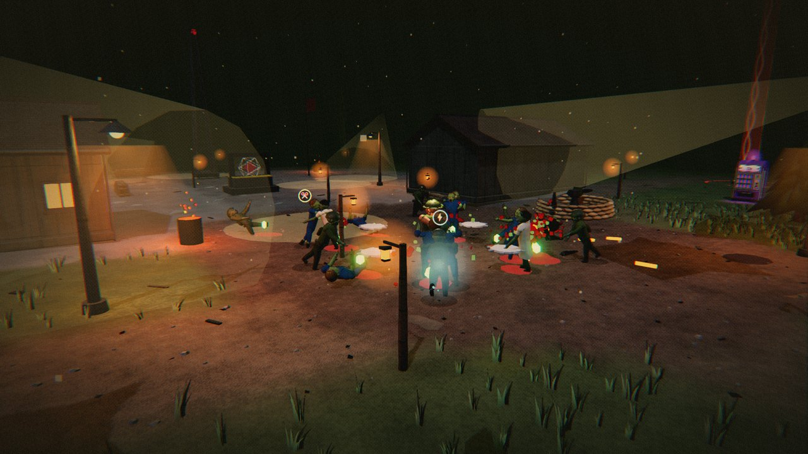 <b>Kessel 9</b> – die Station, in der alles begann: Labor, Kaserne, Güterbahnhof.</td>
<td width="50%">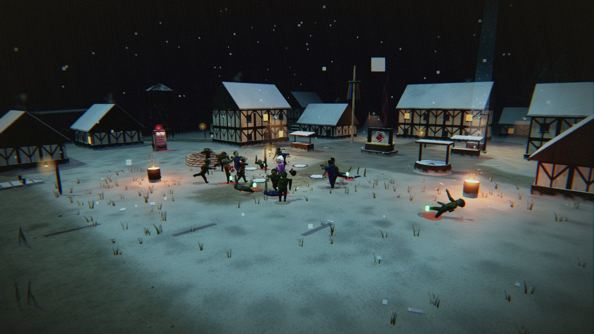 <b>Wolfsgrund</b> – Dorf am zugefrorenen See. Das Eis hält. Meistens.</td>
</tr>
<tr>
<td>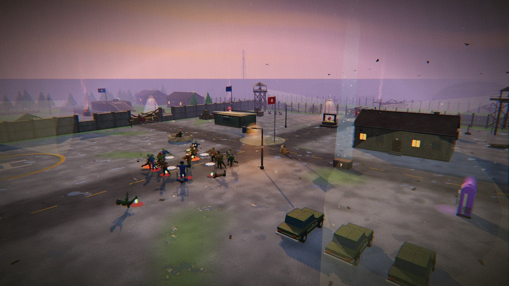 <b>Fort Granit</b> – Armeebasis mit Flugfeld auf einem Felsplateau über dem Meer.</td>
<td>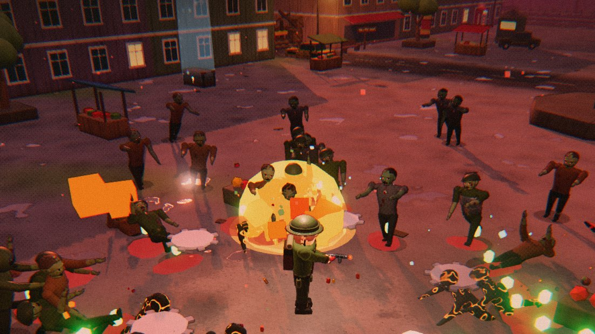 <b>Grauheim</b> – Küstenstadt mit Kanal, Brücken und Kaufhaus.</td>
</tr>
<tr>
<td>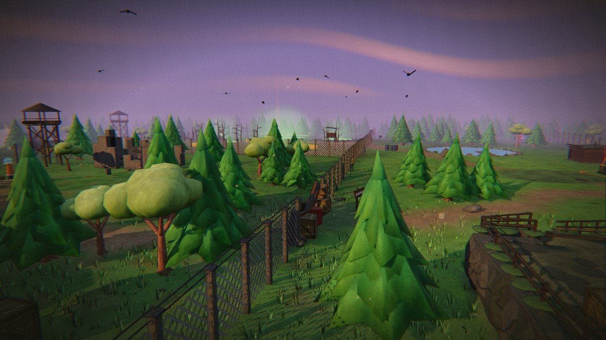 <b>Seuchenwald</b> – vom Waldlager bis zur Funkstation, oder quer durchs giftige Moor.</td>
<td>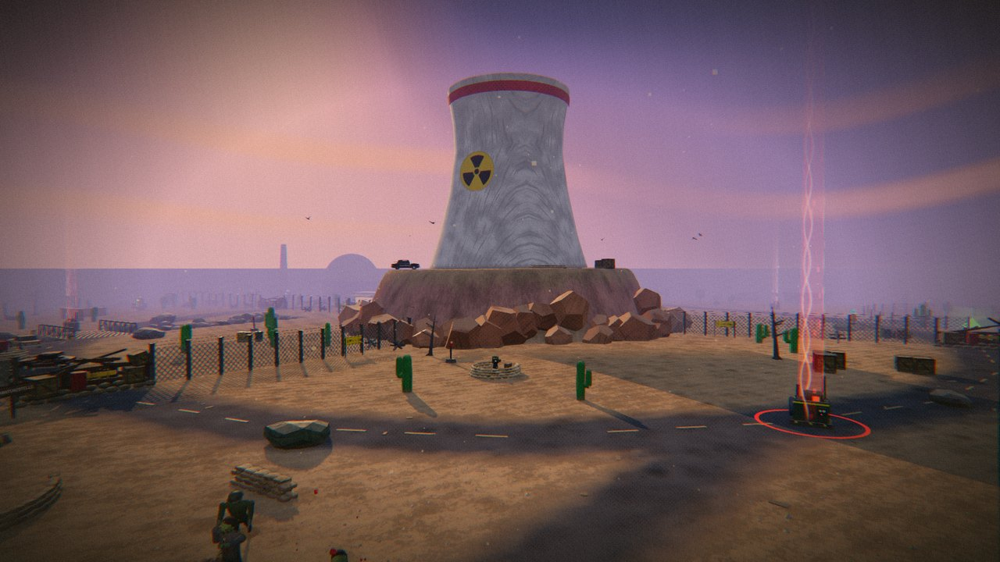 <b>Atomwüste</b> – Testgelände um einen Tafelberg mit Kühlturm.</td>
</tr>
</table>

  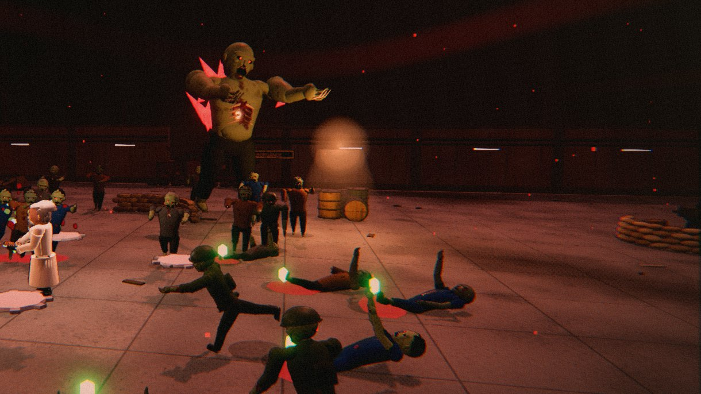
   <b>Ebene 9</b> – das Finale. Evakuiere auf drei Karten, dann fährt der Aufzug nach unten. Dort wartet Echo – und drei Enden.

 

## Spielen

| | |
|---|---|
| 🪟 **Windows** (empfohlen) | **[Download-Seite](https://beydo7.github.io/rotfall-releases/release/)** – ZIP laden, entpacken, `ROTFALL.exe` starten. Alle Grafik-Details, Koop. |
| 🌐 **Browser** | **[Jetzt spielen](https://beydo7.github.io/rotfall-releases/play/)** – sofort in Chrome oder Edge, mit einfacherer Grafik. |
| 🧪 **Playtest** | **[Testversion](https://beydo7.github.io/rotfall-releases/test/)** – das nächste Update vorab. Kann Fehler enthalten. |

> [!TIP]
> Warnt Windows mit *„Der Computer wurde durch Windows geschützt“*? **„Weitere Informationen“ → „Trotzdem ausführen“.** Das Spiel ist nur noch nicht signiert. Bei einem Update bleibt dein Fortschritt erhalten – und wer die alte Version gespielt hat, nimmt seinen Fortschritt automatisch mit.

**Systemanforderungen:** Windows 10 oder 11 (64-Bit) und eine Grafikkarte mit Vulkan-Unterstützung. Genaue Mindest- und Empfehlungswerte stehen auf der [Download-Seite](https://beydo7.github.io/rotfall-releases/release/). Im Spiel misst **Optionen → Grafik → „Leistungstest starten“**, wie gut ROTFALL auf deinem PC läuft.

 

## Steuerung

| Aktion | Tastatur & Maus | Controller |
|---|:-:|:-:|
| Laufen · Kamera | <kbd>W</kbd> <kbd>A</kbd> <kbd>S</kbd> <kbd>D</kbd> · Maus | linker · rechter Stick |
| Springen | <kbd>Leertaste</kbd> | <kbd>A</kbd> / <kbd>✕</kbd> |
| Ausweichen | <kbd>Shift</kbd> | <kbd>B</kbd> / <kbd>◯</kbd> |
| Benutzen | <kbd>E</kbd> | <kbd>X</kbd> / <kbd>▢</kbd> |
| Spezialfähigkeit | <kbd>Q</kbd> / Rechtsklick | <kbd>Y</kbd> / <kbd>△</kbd> |
| Upgrade wählen | <kbd>1</kbd> <kbd>2</kbd> <kbd>3</kbd> | Steuerkreuz + <kbd>A</kbd> |
| Werte-Übersicht (halten) | <kbd>Tab</kbd> | <kbd>L3</kbd> |
| Pause | <kbd>Esc</kbd> | <kbd>Start</kbd> |
| Vollbild · Fehlerbericht kopieren | <kbd>F11</kbd> · <kbd>F8</kbd> | |

Jede Taste lässt sich unter <b>Optionen → Tastenbelegung</b> ändern.

 

## Fragen & Antworten

<b>Was kostet das Spiel?</b>

 

Nichts. ROTFALL ist während der Entwicklung kostenlos spielbar – als Windows-Version und im Browser.

<b>Läuft das Spiel auf meinem PC?</b>

 

Starte im Spiel **Optionen → Grafik → „Leistungstest starten“**. Nach etwa sechs Minuten siehst du, welche Grafikstufe flüssig läuft. Ruckelt es, stell die Voreinstellung auf **„Mittel“** oder **„Niedrig“**.

<b>Wie spiele ich mit einem Freund?</b>

 

In der Windows-Version: Hauptmenü → **Koop**. Einer erstellt das Spiel, der andere tritt bei. Ihr teilt euch die Horde, die Generatoren und die Evakuierung – Waffen, Beförderungen und Schrott hat jeder für sich. Geht einer zu Boden, hilft der andere ihm auf. Im Browser gibt es keinen Koop.

<b>Behalte ich meinen Fortschritt aus der alten Version?</b>

 

Ja. Beim ersten Start übernimmt ROTFALL deinen Fortschritt aus der vorherigen Version automatisch – Figuren, Splitter, Auszeichnungen, Lager und Rekorde.

<b>Gibt es das Spiel auf Englisch?</b>

 

Ja, und in sechs weiteren Sprachen: **Deutsch · English · Español · Français · Português (BR) · Русский · 简体中文 · 日本語**. Umstellen unter **Optionen → Anzeige → „Sprache · Language“**.

<b>Ich habe einen Fehler gefunden oder eine Idee.</b>

 

Super! Im Spiel **F8** drücken – das kopiert einen Fehlerbericht in die Zwischenablage. Dann hier ein [Issue anlegen](https://github.com/beydo7/rotfall-releases/issues/new/choose) (Vorlagen „Fehler“ und „Idee“) oder im [Discord](https://discord.gg/6yuVzSg8vg) melden.

 

  &nbsp;
  &nbsp;
  

ROTFALL ist ein Hobbyprojekt von Pascal, entwickelt mit KI. Hör auf Echo. Meistens.

