

  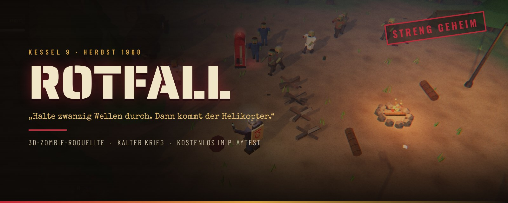

  

  
  
  
  
  
  

  &nbsp;&nbsp;
  

<b>Kostenlos</b> &nbsp;·&nbsp; keine Anmeldung &nbsp;·&nbsp; dein Fortschritt bleibt bei Updates erhalten

> [!TIP]
> **Neu in v2.5:** ⚙️ deutlich flüssiger bei großen Horden, Grafik-Voreinstellungen mit **Automatik** · ✨ weiche Schatten in Ecken, Lichtkegel im Nebel, bewegtes Meer, Druckwellen, 3D-Lager · ▶️ **Einsatz fortsetzen** nach dem Schließen · 📻 Funkprotokoll und Untertitel · 🛒 Vorschau der nächsten Welle im Nachschub · 🧭 aufgeräumter Bildschirm
>
> **Seit v2.2:** 🔊 echte Sounds mit ruhigem, räumlichem Mix
>
> **Seit v2.0:** 🔻 [Das Finale auf Ebene 9](#ebene9) mit Echo als Endgegner und drei Enden · 🧬 [Weiterentwicklungen für alle 17 Waffen](#evo) · 🧟 bis zu 250 Zombies gleichzeitig, die humpeln, kriechen und Arme verlieren · ⚡ [Ereignisse mitten in der Welle](#ereignisse) · 🏕️ [Das Lager](#lager) für dauerhafte Verbesserungen · 🧑‍🔬 neuer Charakter Prof. Konrad Wendt

 

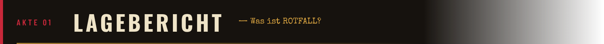

> [!CAUTION]
> **VERSCHLUSSSACHE · PROJEKT ROTFALL · NUR FÜR DEN DIENSTGEBRAUCH**

**Herbst 1968.** Ein Meteorit schlägt in den Bergen nahe der geheimen Forschungsstation **Kessel 9** ein. Die Wissenschaftler nennen das rot glühende Gestein **Rotium**. Es lässt Tote wieder aufstehen.

Drei Wochen später bricht die Eindämmung zusammen. Die Tore sind verriegelt, der Strom ist weg. Dann knackt das alte Funkgerät am Sendemast, und eine Stimme meldet sich, die sich **Echo** nennt.

Woher Echo das alles weiß? Darüber denkst du später nach. **Jetzt kommen sie.**

Und irgendwann, wenn du oft genug überlebt hast, ruft Echo dich nach unten. Auf **Ebene 9**.

  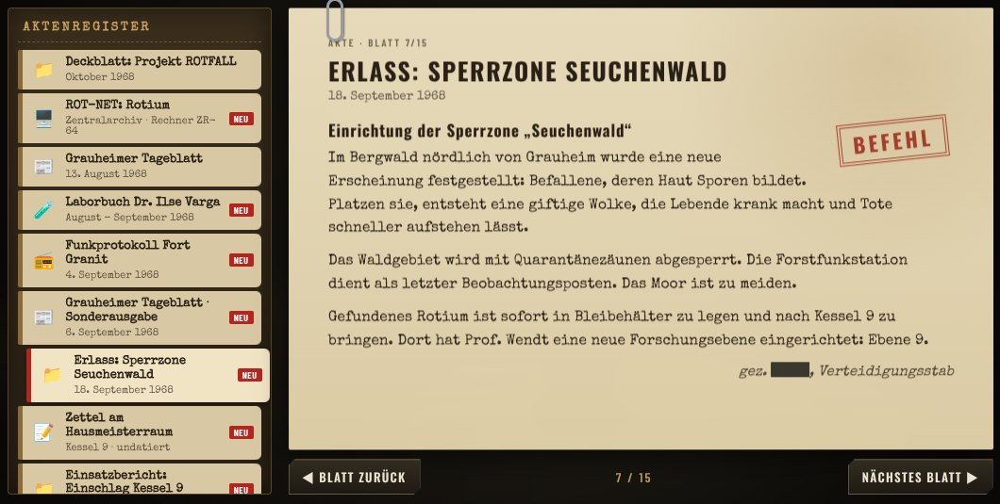
   <i>Die ganze Geschichte findest du im Hauptmenü unter <b>Die Akte</b> (20 Blätter): Geheimakten, Zeitungsartikel, Funkprotokolle, Laborberichte und das ROT-NET-Archiv. Weitere Blätter schaltest du durch deinen Fortschritt frei.</i>

  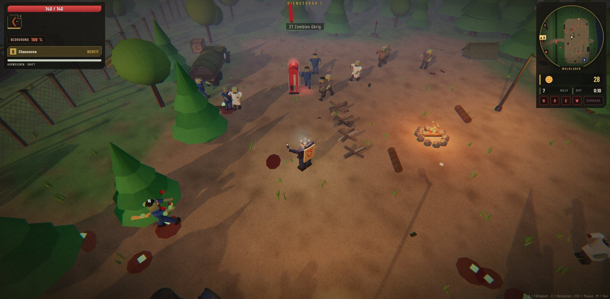
   <i>Erste Welle im Waldlager. Deine Waffen feuern von allein, du hältst die Horde auf Abstand.</i>

**ROTFALL** ist ein 3D-Survival-Roguelite mit Zombies, angelehnt an Spiele wie *Megabonk* und den Zombie-Modus aus *Call of Duty*. Deine Waffen feuern **automatisch**, du konzentrierst dich aufs Überleben: ausweichen, Beute einsammeln, aufrüsten, Entscheidungen treffen. Jede Welle bringt mehr Zombies, jede Beförderung macht dich stärker, und jeder Einsatz läuft anders.

 

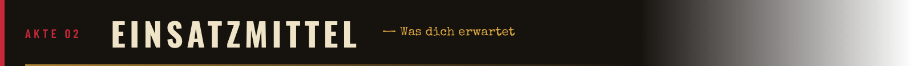

<table>
<tr>
<td width="50%" valign="top">

### 🔫 17 Waffen
Von der Dienstpistole bis zur Tesla-Spule. Jede ist in **5 Stufen** aufrüstbar, lässt sich einmal in der **Rotium-Schmiede veredeln** und mit dem passenden Upgrade **weiterentwickeln**.

</td>
<td width="50%" valign="top">

### 📻 Echos Befehle
Mitten im Kampf funkt Echo Aufträge: Funkcode bergen, Stellung halten, Sprengsatz entschärfen. Schaffst du es nicht rechtzeitig, löscht ein Rotium-Schlag alles aus. Auch dich.

</td>
</tr>
<tr>
<td valign="top">

### ⚙️ Generatoren & Schmiede
Bring vier Generatoren ans Netz, dann startet die Schmiede im Zentrum. Aber die Toten greifen laufende Generatoren an.

</td>
<td valign="top">

### 🎲 Wunderkiste & Perks
Zufällige Waffen aus der Kiste, Perks aus den Automaten: Zweite Chance, Doppelabzug, Schnellhand-Serum und mehr.

</td>
</tr>
<tr>
<td valign="top">

### 🩸 Echos Pakte
Echo bietet dir Macht an, aber jeder Pakt hat seinen Preis. Doppelter Schrott, dafür weniger Heilung? Du entscheidest.

</td>
<td valign="top">

### 🆘 Überlebende retten
Befreie Gefangene aus Käfigen. Soldaten kämpfen an deiner Seite, Wissenschaftler halten Generatoren am Laufen.

</td>
</tr>
<tr>
<td valign="top">

### 🧟 Die Horde lebt
Bis zu **250 Zombies** gleichzeitig. Sie schlurfen, humpeln und taumeln, verlieren Arme und Beine und kriechen dann weiter. Feuer verkohlt sie, Eis lässt sie zerspringen, Strom lässt sie zucken. Ab Welle 6 kommen Eigenschaften dazu: brennend, gepanzert, spaltend …

</td>
<td valign="top">

### 🌧️ Jede Nacht anders
Wetter, Wäldchen und Deckung werden bei jedem Einsatz neu gewürfelt. Kein Durchgang gleicht dem anderen.

</td>
</tr>
<tr>
<td valign="top">

### 🚁 Die Evakuierung
Welle 20 geschafft? Noch nicht ganz. Der Helikopter landet, und du musst **30 Sekunden die Landezone halten**, während die Horde nicht aufhört.

</td>
<td valign="top">

### ⚡ Ereignisse
Mitten in der Welle geht das Licht aus, ein Flugzeug wirft Kisten ab oder der Blutmond geht auf. Jede Karte hat dazu ihr eigenes Ereignis: Artillerie, Großbrand, Sporenregen, Strahlungssturm …

</td>
</tr>
<tr>
<td valign="top">

### 🔥 Bedrohungsstufen
Zu leicht geworden? Nach deinem ersten Sieg drehst du die **Bedrohung von 1 bis 10** hoch: zähere, schnellere Zombies, mehr Elite, teurerer Nachschub. Dafür gibt es mehr Rotium-Splitter.

</td>
<td valign="top">

### 🖋️ Grusel-Comic-Look
Tuschekonturen, gestufte Schatten und Rasterpunkte wie in einem gedruckten Heft. Zombies mit Augenhöhlen, Zähnen und Blutflecken. Abschaltbar in den Optionen.

</td>
</tr>
</table>

<table>
<tr>
<td width="58%" valign="top">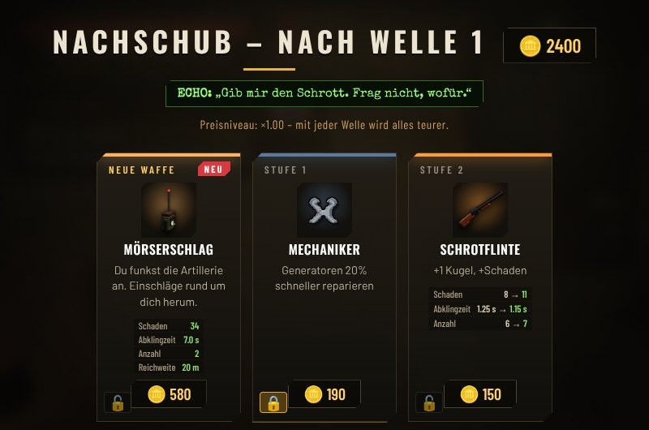</td>
<td width="42%" valign="top">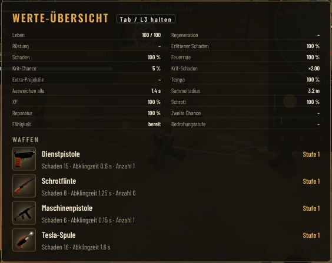</td>
</tr>
<tr>
<td valign="top"><b>Nachschub:</b> Mit dem 🔒 Schloss legst du dir ein Angebot zurück, es bleibt beim Neu-Würfeln und in der nächsten Runde liegen. Grüne Zahlen zeigen, was sich gegenüber deiner Stufe verbessert. <kbd>Leertaste</kbd> startet die nächste Welle.</td>
<td valign="top"><b>Werte-Übersicht:</b> <kbd>Tab</kbd> gedrückt halten zeigt alle Werte, Waffen und Perks auf einen Blick.</td>
</tr>
</table>

<table>
<tr>
<td width="50%" valign="top">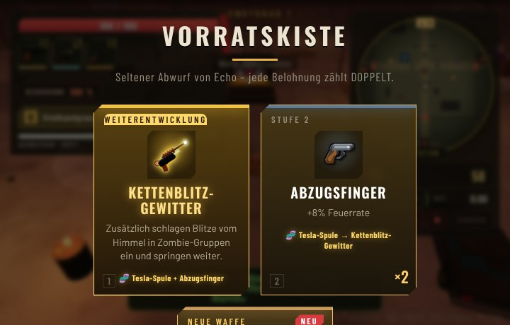</td>
<td width="50%" valign="top">

### 🧬 Weiterentwicklungen
Bringst du eine Waffe auf **Stufe 5** und hast das **passende Upgrade**, bietet dir die nächste Vorratskiste die Weiterentwicklung an. Die Waffe spielt sich danach **anders**: Die Tesla-Spule ruft Blitze vom Himmel, Schrotkugeln prallen ab, Kreissägen heilen dich.

Auf jeder Karte steht, was zusammenpasst. Alle 17 findest du im Lexikon, solange unentdeckt als „???“.

</td>
</tr>
</table>

  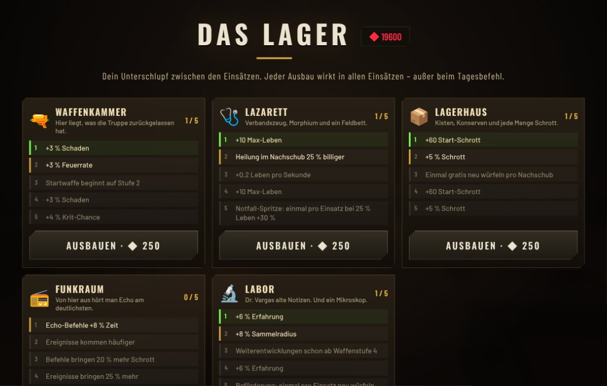
   <i><b>Das Lager:</b> Steck deine Rotium-Splitter in Waffenkammer, Lazarett, Lagerhaus, Funkraum und Labor. Jede Station hat 5 Stufen, kleine Boni für alle Einsätze. Zurücksetzen ist jederzeit kostenlos, beim Tagesbefehl zählt das Lager nicht.</i>

<b>🔁 So läuft ein Einsatz ab</b> (aufklappen)

 

 

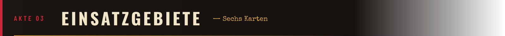

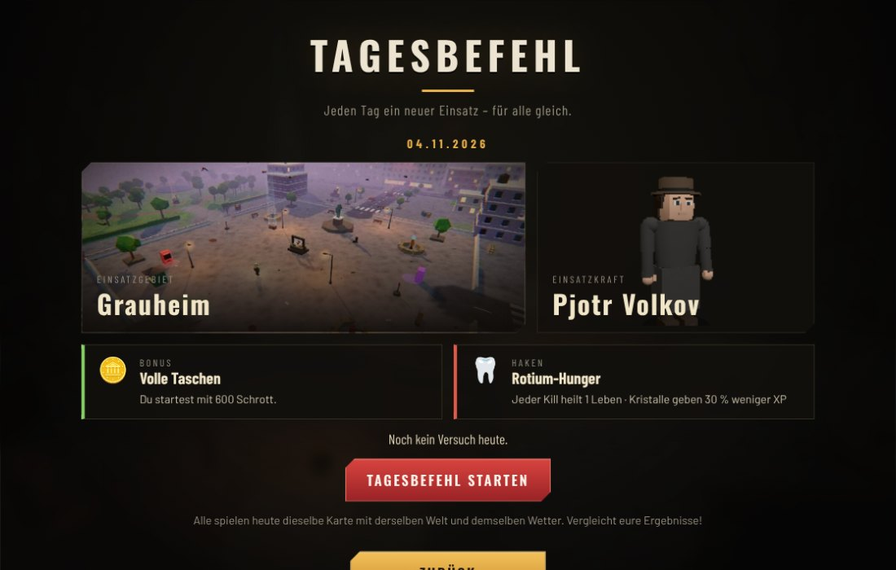

Jeden Tag gibt Echo einen neuen Befehl aus, und **für alle ist er gleich**:

- 🗺️ dieselbe Karte, dieselbe Welt, dasselbe Wetter
- 🎖️ derselbe Charakter (auch wenn du ihn noch nicht freigeschaltet hast)
- ➕ ein **Bonus**, zum Beispiel eine schon veredelte Startwaffe
- ➖ ein **Haken**, zum Beispiel einer von Echos Pakten oder die Horde mit 150 % Bedrohung

Dein Tagesbestwert wird gespeichert. Mit **„Ergebnis kopieren“** landet er als kurzer Text in der Zwischenablage. Ab in den Chat und vergleichen, wer am weitesten kommt!

 
 

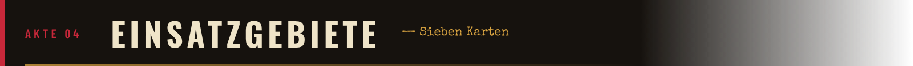

<table>
<tr>
<td width="50%">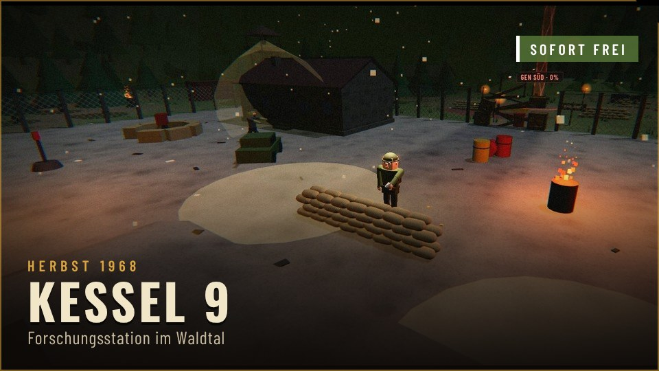</td>
<td width="50%">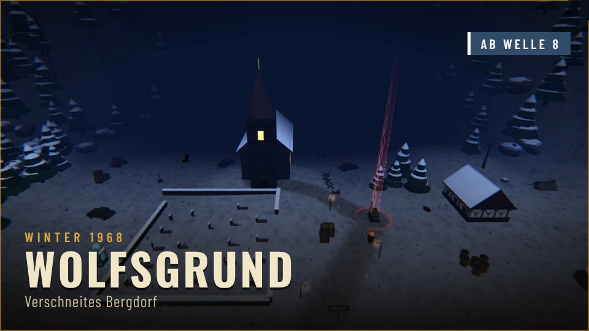</td>
</tr>
<tr>
<td valign="top">Die Station, in der alles begann. Laborkomplex, Meteorkrater mit Hubschrauberwrack, Kaserne und Fahrzeugdepot in einem bewaldeten Tal.</td>
<td valign="top">Sägewerk, Kirche mit Friedhof, ein gefrorener See und ein kleiner Bahnhof. Größer, kälter, dunkler. Die Glocke läutet nachts von allein.</td>
</tr>
<tr>
<td>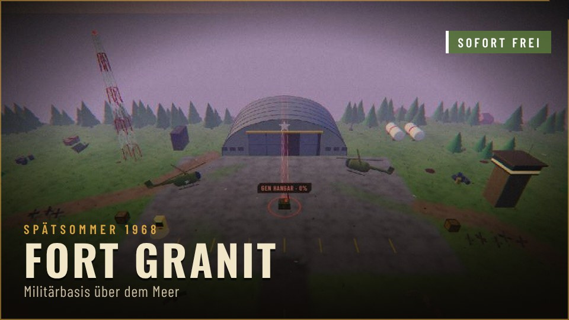</td>
<td>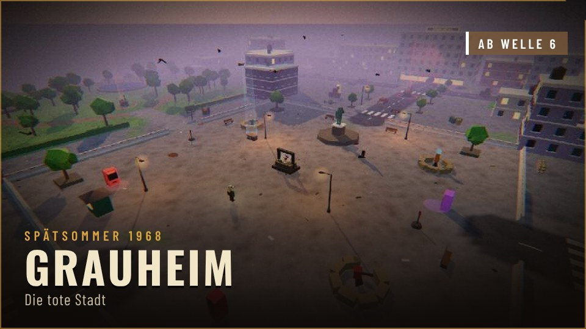</td>
</tr>
<tr>
<td valign="top">Die verlassene Armeebasis auf einem Felsplateau über dem Meer: Hangar mit Hubschraubern, Panzerdepot, Haupttor und Kaserne.</td>
<td valign="top">Grand Hotel mit Leuchtschrift, Kino, Tankstelle, Stadtpark und ein verbarrikadierter Marktplatz. Brennende Ruinen hoch über der Küste.</td>
</tr>
<tr>
<td>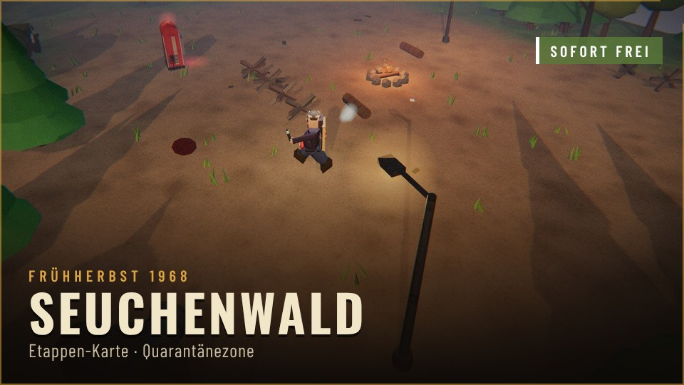</td>
<td>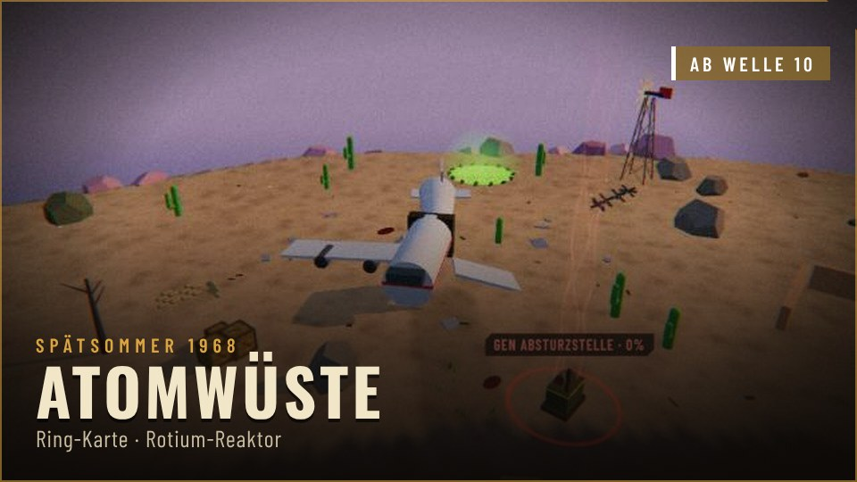</td>
</tr>
<tr>
<td valign="top"><b>Etappen-Karte:</b> Vom Waldlager über die Lichtung bis zur Funkstation kämpfst du dich Stück für Stück vor. Oder du wagst dich ins giftige Moor.</td>
<td valign="top"><b>Ring-Karte</b> um einen Tafelberg mit Kühlturm. Sind alle Tore offen, läufst du einmal im Kreis, die Horde immer hinter dir.</td>
</tr>
</table>

  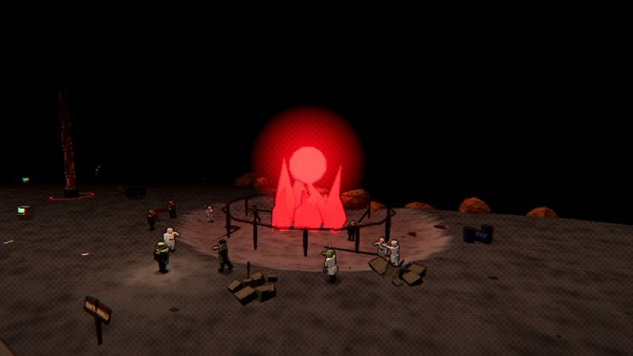

> [!IMPORTANT]
> **🔻 Ebene 9 – das Finale.** Evakuiere auf **drei verschiedenen Karten**, dann öffnet sich der Aufzug nach unten: Laborgänge, Zellenblock, Archiv, Kühlräume und die Reaktorhalle mit dem roten Kern. In Welle 20 wartet erst der Erstgeborene, dann **Echo selbst**. Danach triffst du eine Entscheidung, und es gibt **drei Enden**. Eines davon erreicht nur Subjekt 0.

  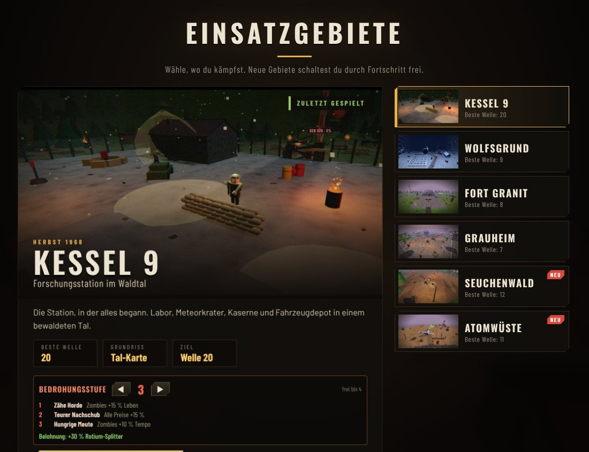
   <i>Die Kartenauswahl: Wolfsgrund schaltest du ab Welle 8 frei, Grauheim ab Welle 6, die Atomwüste ab Welle 10, Ebene 9 nach drei Evakuierungen. Unten wählst du die <b>Bedrohungsstufe</b>, jeder Sieg schaltet die nächste frei.</i>

 

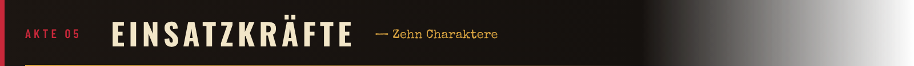

  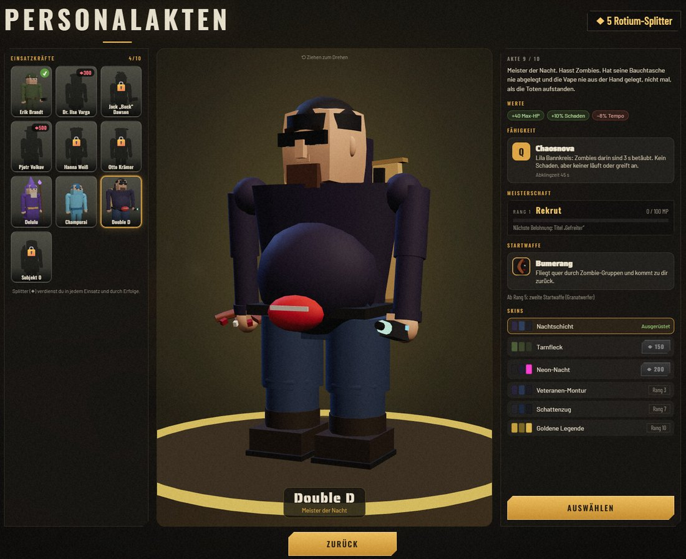

Elf Charaktere, jeder mit eigener Startwaffe, eigenen Werten und einer **Spezialfähigkeit** (<kbd>Q</kbd>). Mit jedem Einsatz steigt ihre **Meisterschaft**: zehn Ränge mit Titeln, Skins und einer zweiten Startwaffe.

| | Charakter | Wer ist das? | Fähigkeit |
|:-:|---|---|---|
| 🎖️ | **Erik Brandt** | Feldwebel, kennt jeden Winkel von Kessel 9 | 💣 Stielhandgranate |
| 🔬 | **Dr. Ilse Varga** | Rotium-Forscherin, weiß mehr, als sie sagt | ⚡ Tesla-Entladung |
| 🇺🇸 | **Jack „Buck“ Dawson** | US-Marine, laut, stur, unkaputtbar | 🐂 Sturmangriff |
| 🕵️ | **Pjotr Volkov** | KGB-Agent, offiziell Übersetzer | 💨 Rauchgranate |
| ⛑️ | **Hanna Weiß** | Sanitäterin, hat aufgehört zu zählen | 💉 Adrenalinspritze |
| 🔧 | **Otto Krämer** | Hausmeister, repariert alles | 🧨 Bastel-Minen |
| ☢️ | **Subjekt 0** | Das erste Testsubjekt. Er erinnert sich an Echo. | 🔴 Rotium-Ausbruch |
| 🧙 | **Delulu** | Magier aus einer anderen Welt | ❄️ Frostnova |
| 🥷 | **Champurai** | Der letzte Ninja aus LuckyTown | 🌫️ Rauchschleier |
| 🕶️ | **Double D** | Meister der Nacht. Hasst Zombies. Vape in der Hand. | 🌀 Chaosnova |
| 🧑‍🔬 | **Prof. Konrad Wendt** | ??? (schaltest du auf Ebene 9 frei) | 🔴 Rotium-Schlag |

 

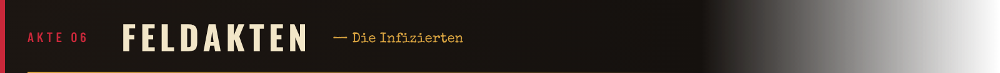

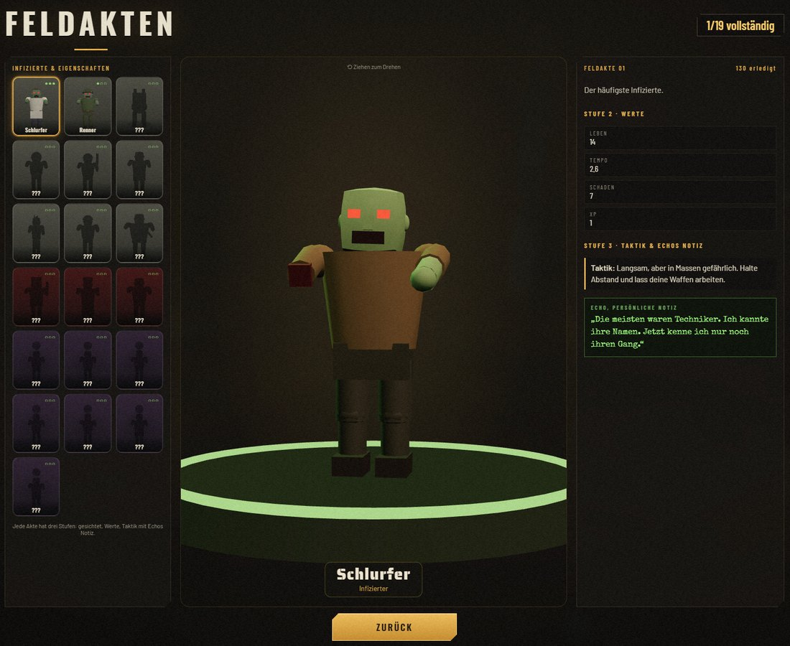

Schlurfer, Renner und Rotköter sind erst der Anfang.

- 💥 **Bomber** explodieren
- 🎯 **Schützen** zielen mit rotem Strahl
- 🧪 **Spucker** werfen Säure
- 🕳️ **Gräber** tauchen direkt neben dir auf
- 📢 **Kreischer** machen alle anderen wild

Dann sind da noch **der Schlachter**, **Oberst Krüger** und *er*: **der Erstgeborene**. Und ganz unten wartet jemand, der dich schon die ganze Zeit kennt.

Alles, was du über sie herausfindest, landet in den **Feldakten**, mit Echos ganz persönlichen Notizen.

 

  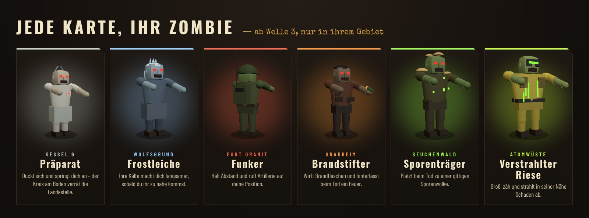

 

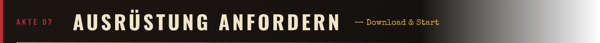

  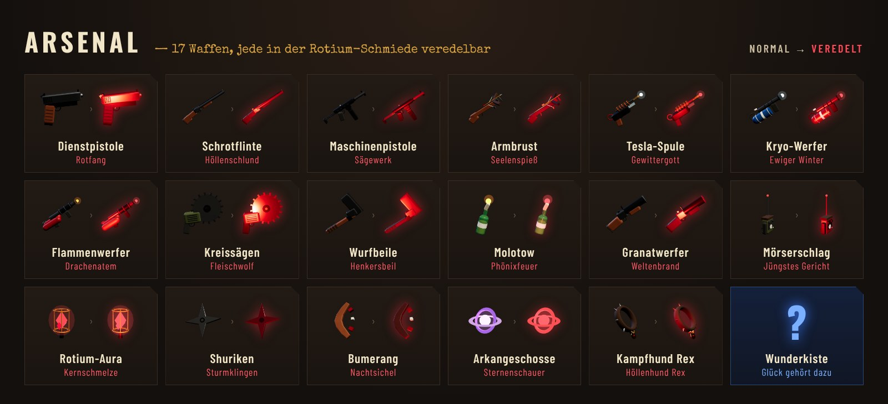

Im **Lexikon** im Hauptmenü findest du jede Waffe mit Wertebalken für jede Stufe und veredelt, dazu Perks, Power-Ups, Pakte und alles Wissenswerte. Mit Suche.

  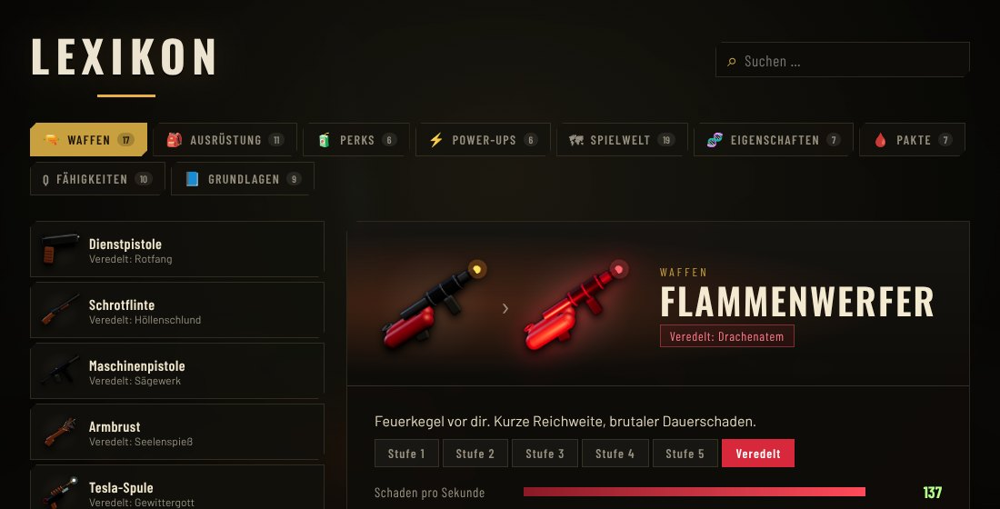

<b>📸 Weitere Bilder</b> (Hauptmenü, Akte)

 

  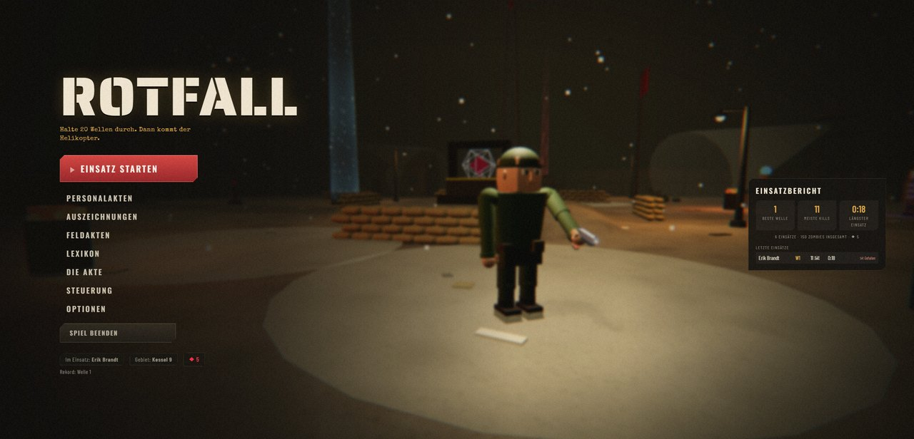  
  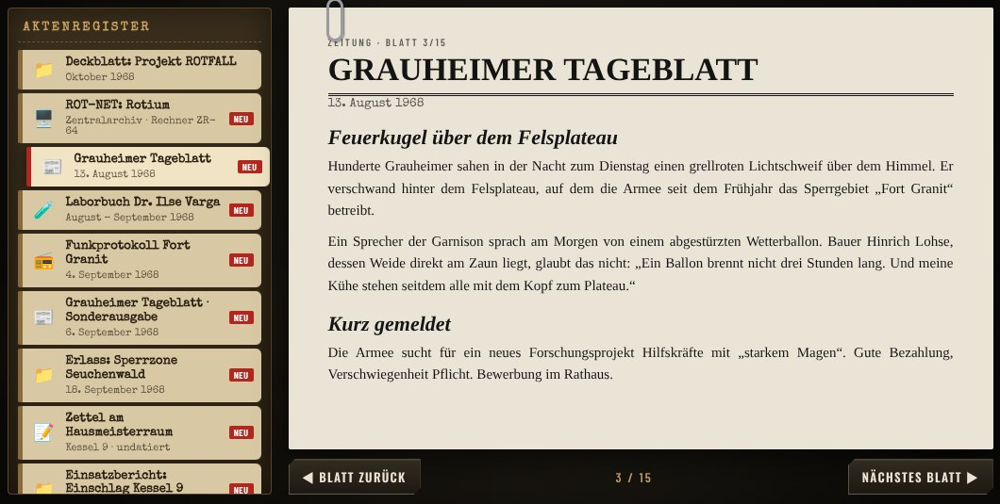

 

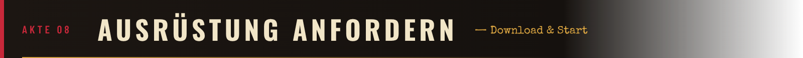

  &nbsp;&nbsp;
  

Auf der [Download-Seite](https://github.com/beydo7/rotfall-releases/releases/latest) findest du ganz unten bei **Assets**:

| Datei | |
|---|---|
| 🖥️ `ROTFALL-…-Windows.zip` | **Empfohlen.** Eigenes Programm mit `ROTFALL.exe` |
| 🌐 `ROTFALL-…-Browser.zip` | Läuft in Chrome oder Edge, ohne Installation |

**Windows in 3 Schritten**
1. `ROTFALL-…-Windows.zip` herunterladen
2. Rechtsklick → **„Alle extrahieren“**
3. **`ROTFALL.exe`** starten

> [!NOTE]
> Warnt Windows mit *„Der Computer wurde durch Windows geschützt“*? Dann auf **„Weitere Informationen“ → „Trotzdem ausführen“** klicken. Das Spiel ist einfach noch nicht signiert.

> [!TIP]
> **Update?** Neue Zip herunterladen, entpacken, fertig. Dein Fortschritt bleibt erhalten.
> Im Browser gespeicherter Fortschritt ist getrennt von der Windows-Version.

 

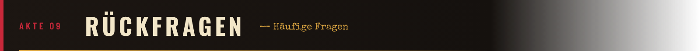

| Aktion | ⌨️ Tastatur & Maus | 🎮 Controller |
|---|:-:|:-:|
| Laufen | <kbd>W</kbd> <kbd>A</kbd> <kbd>S</kbd> <kbd>D</kbd> | linker Stick |
| Kamera drehen | 🖱️ Maus | rechter Stick |
| Springen | <kbd>Leertaste</kbd> | <kbd>A</kbd> / <kbd>✕</kbd> |
| Ausweichen (kurz unverwundbar) | <kbd>Shift</kbd> | <kbd>B</kbd> / <kbd>◯</kbd> |
| Benutzen (Trümmer, Automaten, Kiste …) | <kbd>E</kbd> | <kbd>X</kbd> / <kbd>▢</kbd> |
| Spezialfähigkeit | <kbd>Q</kbd> / Rechtsklick | <kbd>Y</kbd> / <kbd>△</kbd> |
| Werte-Übersicht (halten) | <kbd>Tab</kbd> | <kbd>L3</kbd> |
| Nächste Welle (im Nachschub) | <kbd>Leertaste</kbd> | <kbd>Y</kbd> / <kbd>△</kbd> |
| Zoom | 🖱️ Mausrad | Trigger |
| Pause | <kbd>P</kbd> / <kbd>Esc</kbd> | <kbd>Start</kbd> |
| Ton an/aus | <kbd>M</kbd> | |
| Upgrade wählen | <kbd>1</kbd> <kbd>2</kbd> <kbd>3</kbd> | Steuerkreuz + <kbd>A</kbd> |
| Vollbild | <kbd>F11</kbd> | |
| Fehlerbericht kopieren | <kbd>F8</kbd> | |

In allen Menüs: Steuerkreuz oder Stick zum Auswählen, <kbd>A</kbd> bestätigen, <kbd>B</kbd> zurück, <kbd>LB</kbd>/<kbd>RB</kbd> wechselt Reiter.

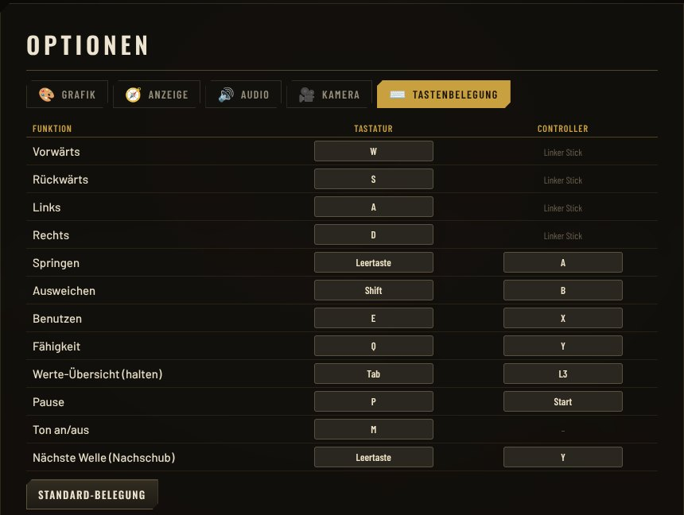

**Lieber andere Tasten?** Unter **Optionen → Tastenbelegung** legst du jede Aktion für Tastatur und Controller selbst fest. Doppelt belegte Tasten tauschen automatisch.

Die Optionen sind in Reiter aufgeteilt: **Grafik, Anzeige, Audio, Kamera und Tastenbelegung**. Unter **Grafik** wählst du eine Voreinstellung (Niedrig bis Ultra) oder lässt die **Automatik** messen und einstellen; darunter sind alle Einzelheiten in Bild, Leistung, Effekte und Stil sortiert. Außerdem: Render-Auflösung, Lautstärke für Effekte und Umgebung, Untertitel für den Funk, Minimap-Größe, Controller-Empfindlichkeit und das Ausblenden von Tipps, Pfeilen und Kill-Serie.

 

 

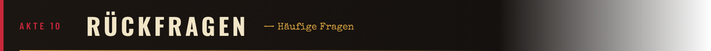

<b>💻 Läuft das Spiel auf meinem PC?</b>

 

Windows 10 oder 11 (64 Bit) und eine Grafikkarte der letzten Jahre reichen. Ruckelt es, drück unter **Optionen → Grafik** auf **„Automatisch“** – das Spiel misst im nächsten Einsatz und stellt sich passend ein. Oder wähl selbst eine niedrigere Voreinstellung bzw. senke Schatten oder Render-Auflösung.

<b>⏸️ Kann ich einen Einsatz unterbrechen?</b>

 

Ja. Geh einfach ins Hauptmenü oder schließ das Spiel – beim nächsten Start steht oben **„Einsatz fortsetzen“**. Deine Waffen, Perks, dein Schrott und Dienstgrad bleiben erhalten; eine angefangene Welle startet neu. Nur der Tagesbefehl lässt sich nicht fortsetzen.

<b>🌍 Gibt es das Spiel auf Englisch?</b>

 

Ja, und in sechs weiteren Sprachen: **Deutsch · English · Español · Français · Português (BR) · Русский · 简体中文 · 日本語**. Umstellen unter **Optionen → Anzeige → „Sprache · Language“**.

<b>🎮 Kann ich mit Controller spielen?</b>

 

Ja. Xbox- und PlayStation-Controller funktionieren im Spiel und in allen Menüs, einfach einstecken oder per Bluetooth verbinden und eine Taste drücken.

<b>📅 Wann gibt es einen neuen Tagesbefehl?</b>

 

Jeden Tag um Mitternacht (deine Ortszeit). Du kannst ihn beliebig oft versuchen, gezählt wird dein bestes Ergebnis des Tages.

<b>💾 Geht mein Fortschritt beim Update verloren?</b>

 

Nein. Charaktere, Skins, Splitter, Erfolge und Meisterschaft bleiben erhalten.

<b>🐛 Ich habe einen Fehler gefunden oder eine Idee!</b>

 

Super, genau dafür ist der Playtest da! Über die Buttons unten kommst du direkt zum passenden Formular. Ein GitHub-Konto brauchst du dafür (kostenlos).

Bei Fehlern: Drück im Spiel <kbd>F8</kbd>. Das kopiert einen Fehlerbericht in die Zwischenablage, den du einfach ins Formular einfügst. Screenshots (<kbd>Win</kbd> + <kbd>Shift</kbd> + <kbd>S</kbd>) helfen sehr.

Kein GitHub-Konto? Dann schick Pascal den F8-Bericht einfach direkt.

 

  &nbsp;&nbsp;
  

---

  🔊 Sounds: <a href="https://sonniss.com/gameaudiogdc">Sonniss #GameAudioGDC</a> und <a href="https://kenney.nl">Kenney</a> (lizenzfrei). 
  <b>🧪 Playtest-Version.</b> ROTFALL ist mitten in der Entwicklung, alles kann sich noch ändern. 
  Was in jeder Version neu ist, steht bei den <a href="https://github.com/beydo7/rotfall-releases/releases">Releases</a>.

ROTFALL · ein Spiel von Pascal · Alle Rechte vorbehalten

<i>📻 Hör auf Echo. Meistens.</i>

