

  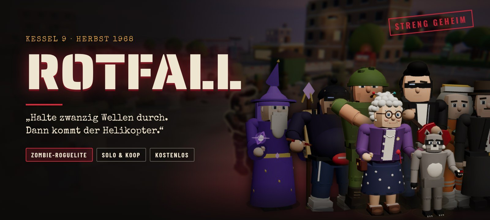

  
  
  
  
  
  

  &nbsp;&nbsp;
  

<b>Kostenlos</b> &nbsp;·&nbsp; keine Anmeldung &nbsp;·&nbsp; dein Fortschritt bleibt bei Updates erhalten

  
  

  <b><a href="#spiel">Das Spiel</a></b> &nbsp;·&nbsp;
  <b><a href="#ablauf">Ablauf</a></b> &nbsp;·&nbsp;
  <b><a href="#features">Features</a></b> &nbsp;·&nbsp;
  <b><a href="#truppe">Figuren</a></b> &nbsp;·&nbsp;
  <b><a href="#karten">Karten</a></b> &nbsp;·&nbsp;
  <b><a href="#koop">Koop</a></b> &nbsp;·&nbsp;
  <b><a href="#horde">Horde & Waffen</a></b> &nbsp;·&nbsp;
  <b><a href="#download">Download</a></b> &nbsp;·&nbsp;
  <b><a href="#steuerung">Steuerung</a></b> &nbsp;·&nbsp;
  <b><a href="#faq">FAQ</a></b>

<b>🇬🇧 English summary</b>

 

**ROTFALL** is a free 3D zombie survival roguelite set in the Cold War, autumn 1968. Think *Megabonk* meets the zombie mode of *Call of Duty*: your weapons fire on their own, you dodge, loot, upgrade and decide. Survive 20 waves, power up the generators, forge your weapons in the Rotium forge and hold the landing zone until the helicopter takes off.

- 15 playable characters, each with its own weapon, ability and personality
- 21 weapons with 21 evolutions, perk machines, a mystery box and generators
- 7 maps, a final level with three endings, daily challenge and threat levels
- Online co-op for two players, controller support, 8 languages (English included)

Play it right in your browser or download the Windows version above. Switch the language under **Options → Display → „Sprache · Language“**.

 

<!-- ═════════════════════════ 01 ═════════════════════════ -->

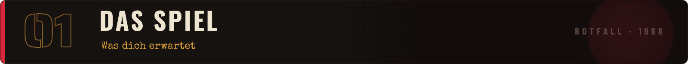

  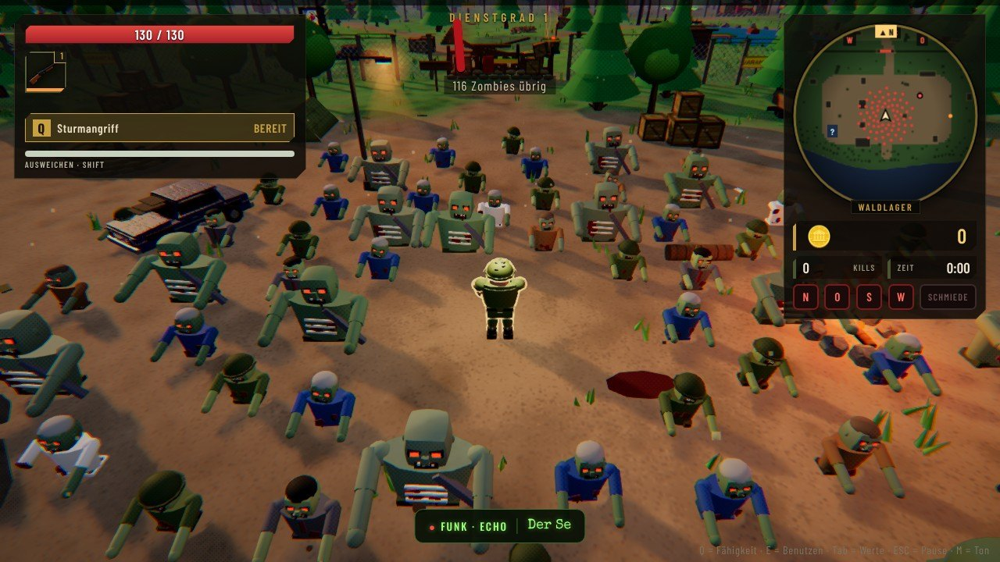

**ROTFALL** ist ein 3D-Zombie-Survival-Roguelite, angelehnt an *Megabonk* und den Zombie-Modus aus *Call of Duty*. Deine Waffen feuern **automatisch**. Du kümmerst dich ums Überleben: laufen, springen, ausweichen, Beute sammeln, aufrüsten, entscheiden. Jede Welle bringt mehr Zombies, jede Beförderung macht dich stärker, und kein Einsatz läuft gleich.

<table>
<tr>
<td width="25%" align="center"><b>🧟 Genre</b> Zombie-Survival-Roguelite</td>
<td width="25%" align="center"><b>📅 Setting</b> Kalter Krieg, Herbst 1968</td>
<td width="25%" align="center"><b>👥 Spieler</b> Solo oder online zu zweit</td>
<td width="25%" align="center"><b>⏱️ Ein Einsatz</b> 20 Wellen, danach Endlos-Modus</td>
</tr>
</table>

**Herbst 1968.** Ein Meteorit schlägt in den Bergen nahe der geheimen Forschungsstation **Kessel 9** ein. Die Wissenschaftler nennen das rot glühende Gestein **Rotium**. Es lässt Tote wieder aufstehen.

Drei Wochen später bricht die Eindämmung zusammen. Die Tore sind verriegelt, der Strom ist weg. Dann knackt das alte Funkgerät, und eine Stimme meldet sich, die sich **Echo** nennt. Sie gibt dir Befehle, bietet dir Pakte an und weiß erstaunlich viel.

Woher Echo das alles weiß? Darüber denkst du später nach. **Jetzt kommen sie.**

📁 Die ganze Geschichte steckt im Hauptmenü unter <b>Die Akte</b>: Geheimakten, Zeitungsartikel, Funkprotokolle und Laborberichte.

 
 

<!-- ═════════════════════════ 02 ═════════════════════════ -->

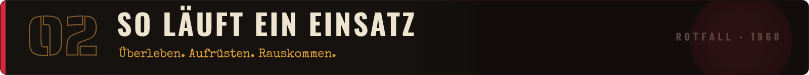

  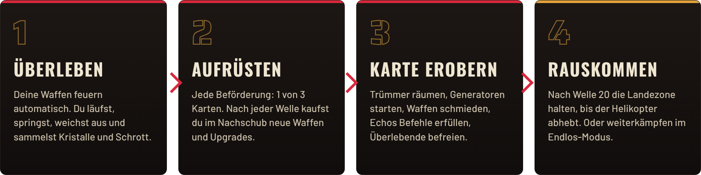

Zwischen den Wellen bekommst du im **Nachschub** eine kurze Atempause: Waffen kaufen, Upgrades zurücklegen, vergleichen, weiter. Mitten im Kampf funkt **Echo** dazwischen: Halte diese Stellung, töte so viele Zombies in 40 Sekunden, bring den Generator ans Netz. Schaffst du es nicht, löscht ein Rotium-Schlag alles aus.

<b>🔁 Der ganze Ablauf als Schaubild</b>

 

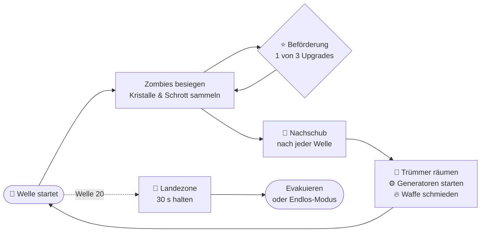

 

<!-- ═════════════════════════ 03 ═════════════════════════ -->

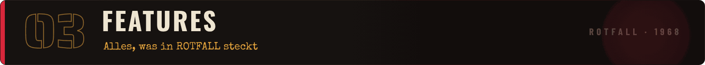

<table>
<tr>
<td width="55%">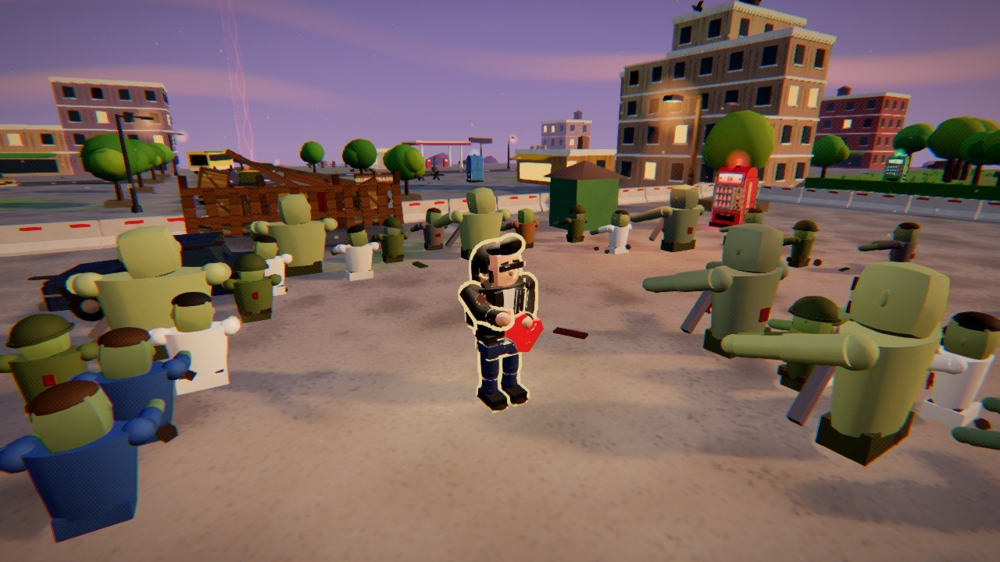</td>
<td width="45%" valign="middle">

### 🧟 Eine Horde, die lebt
Bis zu **250 Zombies** gleichzeitig. Sie schlurfen, humpeln und kriechen weiter, wenn sie ein Bein verlieren. Feuer verkohlt sie, Kälte lässt sie zerspringen, Blitze schleudern sie durch die Luft.

Neun Gegnertypen, ein eigener Zombie pro Karte und vier Bosse.

</td>
</tr>
<tr>
<td valign="middle">

### 🔫 21 Waffen, 21 Weiterentwicklungen
Von der Dienstpistole bis zum Schwerkraftwerfer. Jede Waffe hat 5 Stufen und lässt sich in der **Rotium-Schmiede** veredeln. Waffe auf Stufe 5 plus das passende Upgrade ergibt eine **Weiterentwicklung**, die sich komplett anders spielt.

Die Tesla-Spule ruft Blitze vom Himmel, Kreissägen heilen dich, das Wollknäuel wird zur Strickliesel.

</td>
<td></td>
</tr>
<tr>
<td>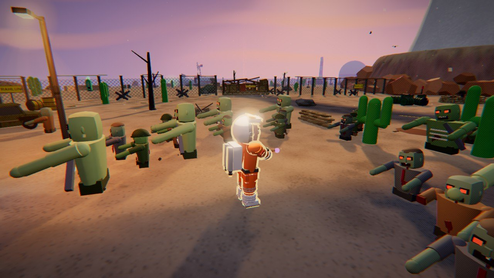</td>
<td valign="middle">

### ⚙️ Die Karte gehört dir
Wie im CoD-Zombie-Modus: **Trümmer räumen**, neue Gebiete öffnen, **vier Generatoren** ans Netz bringen und verteidigen. Dann startet die **Schmiede**. Dazu **Perk-Automaten**, die **Wunderkiste** mit Zufallswaffen und Geschütze, die du aufstellst.

Befreite Überlebende kämpfen mit oder halten einen Generator am Laufen.

</td>
</tr>
</table>

<table>
<tr>
<td width="33%" valign="top">

**📻 Echos Befehle** 
Aufträge mitten im Kampf, mit Belohnung oder Strafe.

</td>
<td width="33%" valign="top">

**🩸 Echos Pakte** 
Macht gegen einen Preis. Doppelter Schrott, dafür weniger Heilung?

</td>
<td width="33%" valign="top">

**⚡ Ereignisse** 
Stromausfall, Blutmond, Abwurfkisten – und je Karte ein eigenes Ereignis.

</td>
</tr>
<tr>
<td valign="top">

**🏕️ Das Lager** 
Rotium-Splitter in dauerhafte Boni stecken: Waffenkammer, Lazarett, Funkraum und mehr.

</td>
<td valign="top">

**🎖️ Meisterschaft** 
Zehn Ränge pro Figur mit Titeln, Skins und einer zweiten Startwaffe. Dazu 30 Erfolge.

</td>
<td valign="top">

**📅 Tagesbefehl** 
Jeden Tag ein Einsatz, für alle gleich: dieselbe Karte, dieselbe Figur, ein Bonus, ein Haken.

</td>
</tr>
<tr>
<td valign="top">

**🔥 Bedrohungsstufen** 
Nach dem ersten Sieg Stufe 1–10: zähere Horde, mehr Belohnung.

</td>
<td valign="top">

**⏸️ Einsatz fortsetzen** 
Jederzeit aufhören. Beim nächsten Start machst du genau dort weiter.

</td>
<td valign="top">

**🖋️ Comic-Look** 
Tuschekonturen und Rasterpunkte wie im gedruckten Heft. Abschaltbar.

</td>
</tr>
</table>

<table>
<tr>
<td width="50%" valign="top">

### 🏕️ Das Lager

</td>
<td width="50%" valign="top">

### 🛒 Der Nachschub

</td>
</tr>
</table>

 

<!-- ═════════════════════════ 04 ═════════════════════════ -->

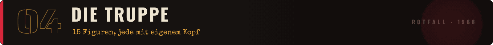

  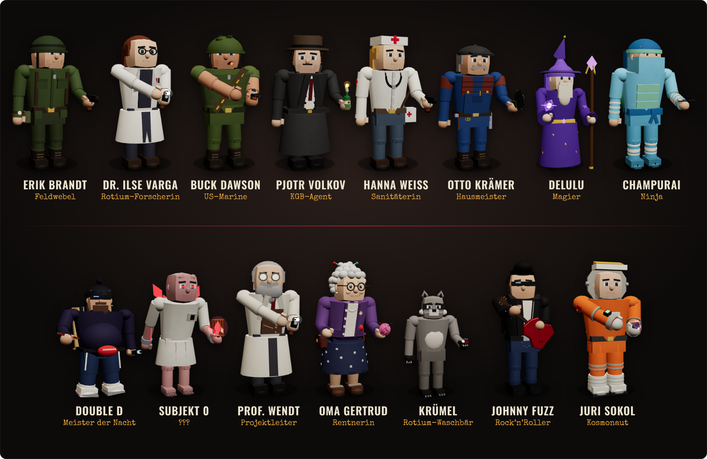

Jede Figur hat eine eigene **Startwaffe**, eigene Werte und eine **Spezialfähigkeit** (<kbd>Q</kbd>). Und jede bewegt sich anders: Juri hüpft wie auf dem Mond, Krümel flitzt mit wippendem Ringelschwanz, Double D watschelt, Subjekt 0 schleicht gebückt.

  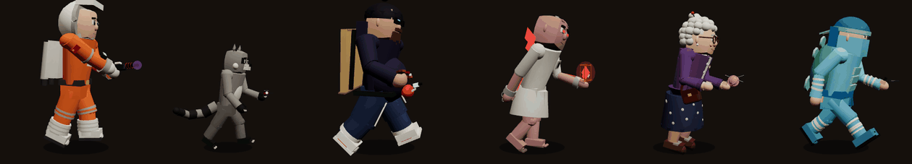

Bleibst du kurz stehen, macht jede Figur **ihr eigenes Ding**: Varga schreibt aufs Klemmbrett, Volkov raucht, Johnny spielt Gitarre, Krümel knabbert einen Keks, Delulu schwebt, Oma Gertrud strickt.

  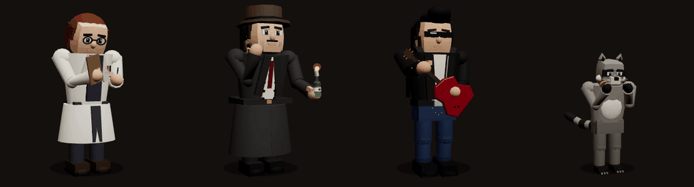
  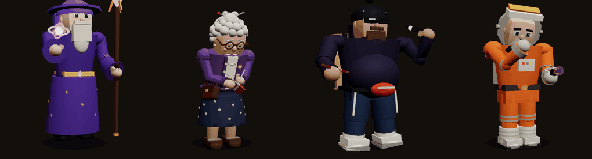

<b>🎖️ Alle 15 Figuren mit Fähigkeit</b>

 

| Figur | Wer ist das? | Fähigkeit | Freischalten |
|---|---|---|---|
| **Erik Brandt** | Feldwebel, kennt jeden Winkel von Kessel 9 | 💣 Stielhandgranate | von Anfang an |
| **Delulu** | Magier aus einer anderen Welt | ❄️ Frostnova | von Anfang an |
| **Champurai** | Der letzte Ninja aus LuckyTown | 🌫️ Rauchschleier | von Anfang an |
| **Double D** | Meister der Nacht. Vape in der Hand. | 🌀 Chaosnova | von Anfang an |
| **Dr. Ilse Varga** | Rotium-Forscherin, weiß mehr, als sie sagt | ⚡ Tesla-Entladung | 300 Rotium-Splitter |
| **Pjotr Volkov** | KGB-Agent, offiziell Übersetzer | 💨 Rauchgranate | 500 Rotium-Splitter |
| **Jack „Buck“ Dawson** | US-Marine, laut, stur, unkaputtbar | 🐂 Sturmangriff | Besiege den Schlachter |
| **Hanna Weiß** | Sanitäterin, hat aufgehört zu zählen | 💉 Adrenalinspritze | Alle 4 Generatoren ans Netz |
| **Otto Krämer** | Hausmeister, repariert alles | 🧨 Bastel-Minen | Erreiche Welle 15 |
| **Subjekt 0** | Das erste Testsubjekt. Er erinnert sich an Echo. | 🔴 Rotium-Ausbruch | Überlebe alle 20 Wellen |
| **Oma Gertrud** | Wohnt seit 1921 in Kessel 9 | 🍰 Frisch gebacken | Spiele 50 Einsätze |
| **Krümel** | Rotium-Waschbär, klaut alles | 🗑️ Mülltonne | Wunderkiste 25-mal benutzen |
| **Johnny Fuzz** | Rock’n’Roll-Gitarrist, kam mit der Truppenbetreuung | 🎸 Gitarrensolo | Kill-Serie von 100 |
| **Major Juri Sokol** | Kosmonaut, seine Kapsel ging 1968 verloren | 🚀 Raketenrucksack | Welle 10 in der Atomwüste |
| **Prof. Konrad Wendt** | ??? | 🔴 Rotium-Schlag | ein Geheimnis auf Ebene 9 |

  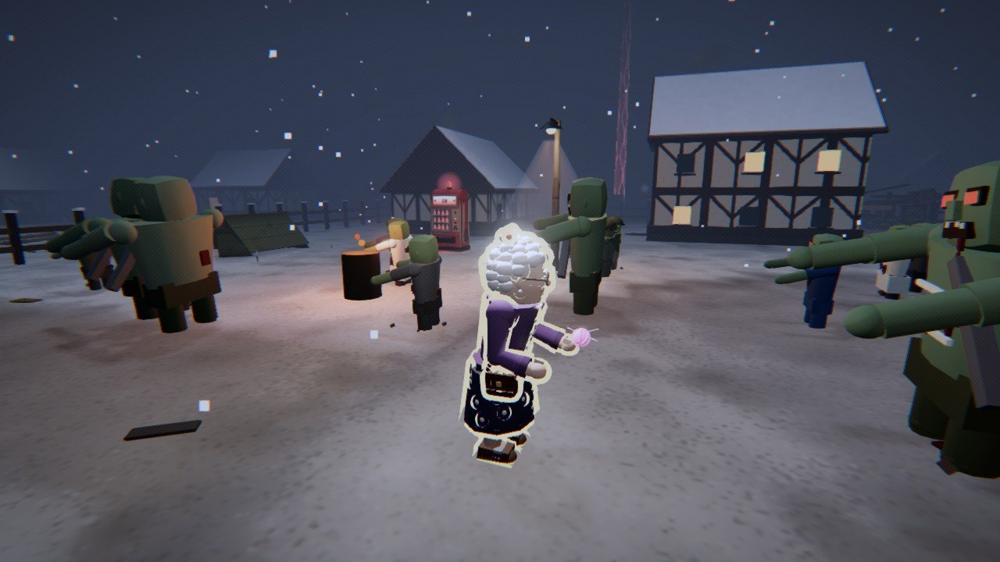
  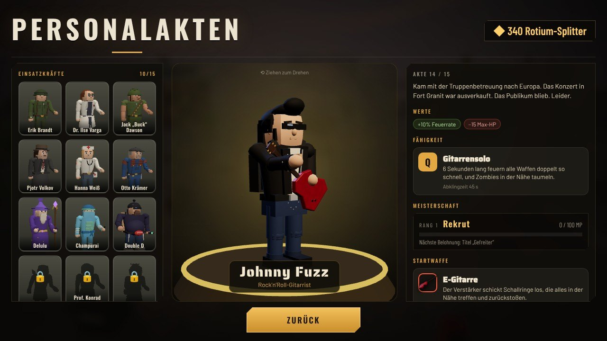

 

<!-- ═════════════════════════ 05 ═════════════════════════ -->

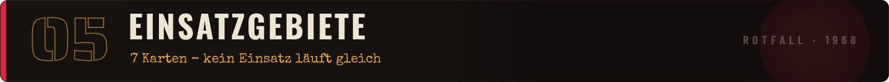

<table>
<tr>
<td width="50%"></td>
<td width="50%"></td>
</tr>
<tr>
<td valign="top"><b>Kessel 9</b> – Die Station, in der alles begann: Laborkomplex, Meteorkrater, Kaserne und Fahrzeugdepot in einem Waldtal.</td>
<td valign="top"><b>Wolfsgrund</b> – Sägewerk, Kirche mit Friedhof, gefrorener See. Die Glocke läutet nachts von allein.</td>
</tr>
<tr>
<td></td>
<td></td>
</tr>
<tr>
<td valign="top"><b>Fort Granit</b> – Verlassene Armeebasis auf einem Felsplateau über dem Meer: Hangar, Panzerdepot, Kaserne.</td>
<td valign="top"><b>Grauheim</b> – Grand Hotel, Kino, Tankstelle und ein verbarrikadierter Marktplatz über der Küste.</td>
</tr>
<tr>
<td></td>
<td></td>
</tr>
<tr>
<td valign="top"><b>Seuchenwald</b> – Etappen-Karte: vom Waldlager über die Lichtung bis zur Funkstation. Oder durchs giftige Moor.</td>
<td valign="top"><b>Atomwüste</b> – Ring-Karte um einen Tafelberg mit Kühlturm. Die Horde immer hinter dir.</td>
</tr>
</table>

  

> [!IMPORTANT]
> **🔻 Ebene 9 – das Finale.** Evakuiere auf **drei verschiedenen Karten**, dann fährt der Aufzug nach unten: Laborgänge, Zellenblock und die Reaktorhalle mit dem roten Kern. In Welle 20 wartet erst der Erstgeborene, dann **Echo selbst**. Danach entscheidest du – es gibt **drei Enden**.

Neue Karten schaltest du über deinen besten Einsatz frei. Unten in der Kartenauswahl wählst du die Bedrohungsstufe.

 

<!-- ═════════════════════════ 06 ═════════════════════════ -->

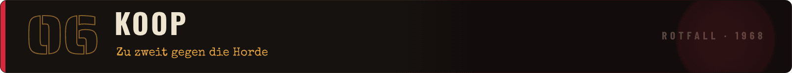

  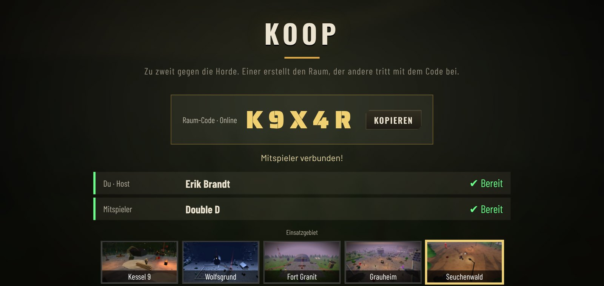

Die Horde ist zu zweit noch schöner. Unter **Koop** im Hauptmenü:

1. **Raum erstellen** – du bekommst einen Code aus 5 Zeichen
2. Code an deinen Freund schicken, er tippt ihn unter **Beitreten** ein
3. Beide wählen ihre Figur, der Host die Karte – **Los!**

| | |
|---|---|
| 🧟 **Gemeinsame Welt** | Zombies, Wellen, Generatoren, Befehle, Ereignisse und die Evakuierung erlebt ihr zusammen |
| 🎒 **Eigener Fortschritt** | Jeder hat seine eigenen Waffen, Beförderungen und seinen eigenen Schrott |
| ⏳ **Bereit 1/2** | Beförderung, Nachschub und Pakte: Die Welt wartet, bis beide fertig sind |
| 🩹 **Wiederbeleben** | Geht einer zu Boden, hilft der andere ihm auf. Erst wenn beide liegen, ist Schluss |
| 🟢 **Immer im Blick** | Dein Mitspieler leuchtet grün – auch hinter Häusern und mitten in der Horde |

Im Koop noch nicht dabei: Tagesbefehl, „Einsatz fortsetzen“ und Ebene 9.

 

<!-- ═════════════════════════ 07 ═════════════════════════ -->

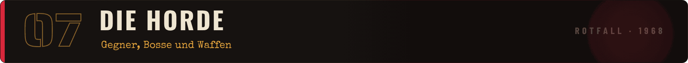

Schlurfer, Renner und Rotköter sind erst der Anfang:

- 💥 **Bomber** explodieren
- 🎯 **Schützen** zielen mit rotem Strahl
- 🧪 **Spucker** werfen Säure
- 🕳️ **Gräber** tauchen direkt neben dir auf
- 📢 **Kreischer** machen alle anderen wild
- 🪨 **Brocken** halten richtig viel aus

Dazu Bosse wie **der Schlachter**, **Oberst Krüger** und **der Erstgeborene**, und jede Karte hat ihren eigenen Zombie: Präparat, Frostleiche, Funker, Brandstifter, Sporenträger und der Verstrahlte Riese. Alles, was du herausfindest, landet in den **Feldakten**, mit Echos persönlichen Notizen.

 

  

  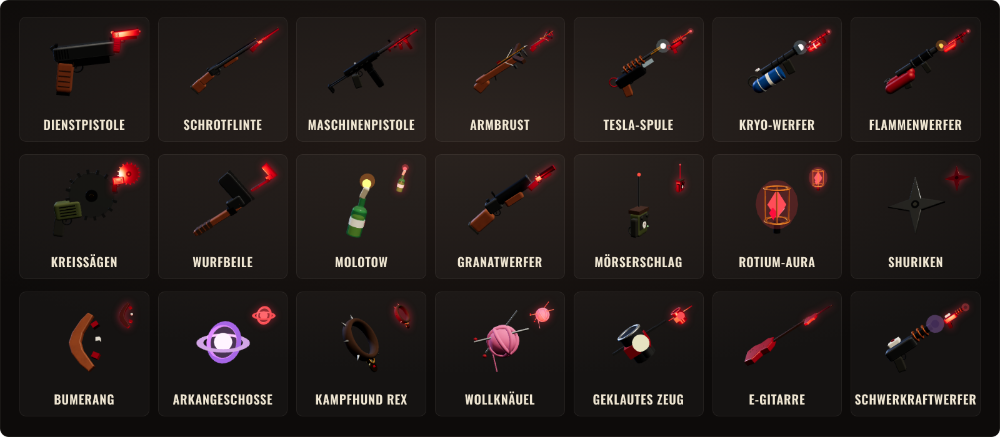
   <i>Alle 21 Waffen, groß normal und klein veredelt. Werte für jede Stufe findest du im <b>Lexikon</b> im Hauptmenü.</i>

 

<!-- ═════════════════════════ 08 ═════════════════════════ -->

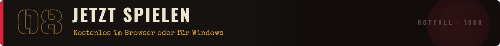

<table>
<tr>
<td width="50%" valign="top" align="center">

### 🌐 Im Browser

Sofort loslegen in Chrome oder Edge. Keine Installation.

</td>
<td width="50%" valign="top" align="center">

### 🖥️ Windows (empfohlen)

<code>ROTFALL-…-Windows.zip</code> laden → Rechtsklick <b>„Alle extrahieren“</b> → <b><code>ROTFALL.exe</code></b> starten

</td>
</tr>
</table>

> [!NOTE]
> Warnt Windows mit *„Der Computer wurde durch Windows geschützt“*? **„Weitere Informationen“ → „Trotzdem ausführen“.** Das Spiel ist nur noch nicht signiert.
>
> **Update?** Neue Zip laden, entpacken, fertig – dein Fortschritt bleibt erhalten. (Browser- und Windows-Spielstände sind getrennt.)

| | |
|---|---|
| 🖥️ **Windows** | Windows 10 oder 11 (64 Bit), Download ca. 140 MB |
| 🌐 **Browser** | aktueller Chrome oder Edge, keine Installation |
| 🎨 **Grafik** | eine Grafikkarte der letzten Jahre (WebGL 2) |
| 🎮 **Eingabe** | Tastatur & Maus oder Xbox-/PlayStation-Controller |

Ruckelt es? Unter <b>Optionen → Grafik</b> auf <b>„Automatisch“</b> stellen – das Spiel misst im nächsten Einsatz und stellt sich passend ein.

 

<!-- ═════════════════════════ 09 ═════════════════════════ -->

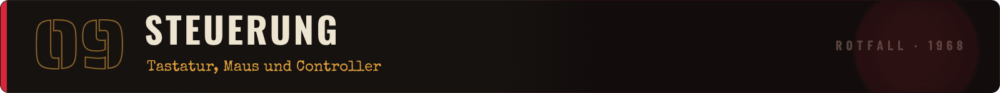

| Aktion | ⌨️ Tastatur & Maus | 🎮 Controller |
|---|:-:|:-:|
| Laufen · Kamera | <kbd>W</kbd> <kbd>A</kbd> <kbd>S</kbd> <kbd>D</kbd> · 🖱️ Maus | linker · rechter Stick |
| Springen | <kbd>Leertaste</kbd> | <kbd>A</kbd> / <kbd>✕</kbd> |
| Ausweichen | <kbd>Shift</kbd> | <kbd>B</kbd> / <kbd>◯</kbd> |
| Benutzen | <kbd>E</kbd> | <kbd>X</kbd> / <kbd>▢</kbd> |
| Spezialfähigkeit | <kbd>Q</kbd> / Rechtsklick | <kbd>Y</kbd> / <kbd>△</kbd> |
| Werte-Übersicht (halten) | <kbd>Tab</kbd> | <kbd>L3</kbd> |
| Pause | <kbd>Esc</kbd> | <kbd>Start</kbd> |

<b>⌨️ Alle Tasten & Optionen</b>

 

| Aktion | ⌨️ Tastatur & Maus | 🎮 Controller |
|---|:-:|:-:|
| Nächste Welle (im Nachschub) | <kbd>Leertaste</kbd> | <kbd>Y</kbd> / <kbd>△</kbd> |
| Upgrade wählen | <kbd>1</kbd> <kbd>2</kbd> <kbd>3</kbd> | Steuerkreuz + <kbd>A</kbd> |
| Zoom | 🖱️ Mausrad | Trigger |
| Pause | <kbd>P</kbd> / <kbd>Esc</kbd> | <kbd>Start</kbd> |
| Ton an/aus | <kbd>M</kbd> | |
| Vollbild | <kbd>F11</kbd> | |
| Fehlerbericht kopieren | <kbd>F8</kbd> | |

In allen Menüs: Steuerkreuz oder Stick zum Auswählen, <kbd>A</kbd> bestätigen, <kbd>B</kbd> zurück, <kbd>LB</kbd>/<kbd>RB</kbd> wechselt Reiter.

Unter **Optionen → Tastenbelegung** legst du jede Taste selbst fest. Unter **Grafik** wählst du eine Voreinstellung (Niedrig bis Ultra) oder lässt die **Automatik** messen. Dazu: Render-Auflösung, Lautstärken, Untertitel für den Funk, Minimap-Größe, Comic-Look, **Eigene Figur hervorheben** und mehr.

 

<!-- ═════════════════════════ 10 ═════════════════════════ -->

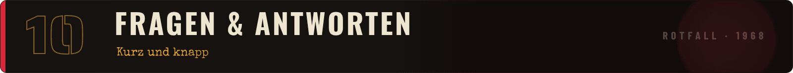

<b>💰 Was kostet das Spiel?</b>

 

Nichts. ROTFALL ist während der Entwicklung kostenlos spielbar, im Browser und als Windows-Version.

<b>💻 Läuft das Spiel auf meinem PC?</b>

 

Windows 10 oder 11 (64 Bit) und eine Grafikkarte der letzten Jahre reichen. Ruckelt es, stell unter **Optionen → Grafik** auf **„Automatisch“**. Siehe auch die [Systemanforderungen](#download).

<b>🤝 Wie spiele ich mit einem Freund?</b>

 

Hauptmenü → **Koop** → **Raum erstellen**. Den Code schickst du deinem Freund, er wählt **Beitreten** und tippt ihn ein. Ihr könnt beide die Browser- oder die Windows-Version nutzen, nur die Version muss gleich sein. Mehr dazu [oben](#koop).

<b>🔍 Ich verliere meine Figur in der Horde aus den Augen.</b>

 

Unter **Optionen → Anzeige → „Eigene Figur hervorheben“** bekommt deine Figur einen gelben Umriss, und hinter Häusern oder Zombies siehst du ihre Silhouette. Standardmäßig ist das an.

<b>⏸️ Kann ich einen Einsatz unterbrechen?</b>

 

Ja. Geh ins Hauptmenü oder schließ das Spiel – beim nächsten Start steht oben **„Weitermachen“**. Waffen, Perks, Schrott und Dienstgrad bleiben, eine angefangene Welle startet neu. Nicht beim Tagesbefehl und im Koop.

<b>🌍 Gibt es das Spiel auf Englisch?</b>

 

Ja, und in sechs weiteren Sprachen: **Deutsch · English · Español · Français · Português (BR) · Русский · 简体中文 · 日本語**. Umstellen unter **Optionen → Anzeige → „Sprache · Language“**.

<b>🎮 Kann ich mit Controller spielen?</b>

 

Ja. Xbox- und PlayStation-Controller funktionieren im Spiel und in allen Menüs – einstecken oder per Bluetooth verbinden und eine Taste drücken.

<b>💾 Geht mein Fortschritt beim Update verloren?</b>

 

Nein. Figuren, Skins, Splitter, Lager, Erfolge und Meisterschaft bleiben erhalten.

 

<!-- ═════════════════════════ 11 ═════════════════════════ -->

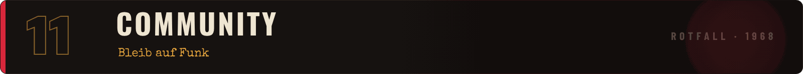

  Neue Versionen, Testaufrufe, Clips und direkter Draht zu Pascal:

  <a href="https://discord.gg/6yuVzSg8vg">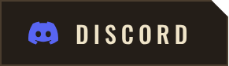</a>&nbsp;&nbsp;
  <a href="https://tiktok.com/@beydyoyo">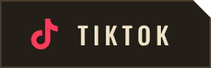</a>&nbsp;&nbsp;
  <a href="https://github.com/beydo7/rotfall-releases">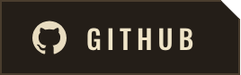</a>

<table>
<tr>
<td width="33%" valign="top" align="center"><b>💬 Discord</b> Patchnotes, Testversionen in <code>#playtest</code>, mit anderen Spielern quatschen</td>
<td width="33%" valign="top" align="center"><b>🎬 TikTok</b> Clips und Einblicke in die Entwicklung</td>
<td width="33%" valign="top" align="center"><b>📦 GitHub</b> Downloads, Releases, Fehler melden und Ideen einreichen</td>
</tr>
</table>

  &nbsp;&nbsp;
  
   Bei Fehlern im Spiel <kbd>F8</kbd> drücken – das kopiert einen Bericht, den du einfach einfügst. Ohne GitHub-Konto? Ab damit in den Discord.

 

---

  <a href="https://discord.gg/6yuVzSg8vg">Discord</a> &nbsp;·&nbsp;
  <a href="https://tiktok.com/@beydyoyo">TikTok</a> &nbsp;·&nbsp;
  <a href="https://github.com/beydo7/rotfall-releases">GitHub</a> &nbsp;·&nbsp;
  <a href="https://github.com/beydo7/rotfall-releases/releases">Alle Versionen</a>

  🔊 Sounds: <a href="https://sonniss.com/gameaudiogdc">Sonniss #GameAudioGDC</a> und <a href="https://kenney.nl">Kenney</a> (lizenzfrei) 
  🧪 <b>Playtest-Version</b> – ROTFALL ist mitten in der Entwicklung, alles kann sich noch ändern. 
  ROTFALL · ein Spiel von Pascal · Alle Rechte vorbehalten

<i>📻 Hör auf Echo. Meistens.</i>

