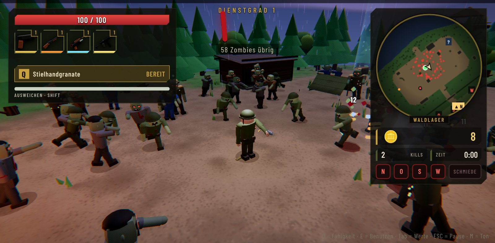

  

  

  
  
  
  
  
  

  &nbsp;&nbsp;
  

<b>Kostenlos</b> &nbsp;·&nbsp; keine Anmeldung &nbsp;·&nbsp; dein Fortschritt bleibt bei Updates erhalten

  
  
  

  <b><a href="#lagebericht">Story</a></b> &nbsp;·&nbsp;
  <b><a href="#features">Features</a></b> &nbsp;·&nbsp;
  <b><a href="#koop">Koop</a></b> &nbsp;·&nbsp;
  <b><a href="#karten">Karten</a></b> &nbsp;·&nbsp;
  <b><a href="#charaktere">Charaktere</a></b> &nbsp;·&nbsp;
  <b><a href="#feinde">Feinde & Waffen</a></b> &nbsp;·&nbsp;
  <b><a href="#download">Download</a></b> &nbsp;·&nbsp;
  <b><a href="#steuerung">Steuerung</a></b> &nbsp;·&nbsp;
  <b><a href="#community">Community</a></b> &nbsp;·&nbsp;
  <b><a href="#faq">FAQ</a></b>

> [!TIP]
> **Neu in v2.7 – Faires Balancing ⚖️** Waffen-Stufen und die Schmiede machen dich nicht mehr übermächtig, die Zombies werden mit jeder Welle spürbar zäher, und Fähigkeiten, Geschütze und Verbündete wachsen mit. Welle 16–20 wird wieder richtig eng.
>
> **v2.6 – 🤝 [Koop zu zweit](#koop):** Raum erstellen, Code an einen Freund schicken, zusammen gegen die Horde.
>
> Alle Änderungen stehen bei den [Releases](https://github.com/beydo7/rotfall-releases/releases).

 

<!-- ═════════════════════════ 01 ═════════════════════════ -->

**Herbst 1968.** Ein Meteorit schlägt in den Bergen nahe der geheimen Forschungsstation **Kessel 9** ein. Die Wissenschaftler nennen das rot glühende Gestein **Rotium**. Es lässt Tote wieder aufstehen.

Drei Wochen später bricht die Eindämmung zusammen. Die Tore sind verriegelt, der Strom ist weg. Dann knackt das alte Funkgerät, und eine Stimme meldet sich, die sich **Echo** nennt.

Woher Echo das alles weiß? Darüber denkst du später nach. **Jetzt kommen sie.**

📁 Die ganze Geschichte steckt im Hauptmenü unter <b>Die Akte</b>: 20 Blätter mit Geheimakten, Zeitungsartikeln, Funkprotokollen und Laborberichten.

 

  

**ROTFALL** ist ein 3D-Survival-Roguelite mit Zombies, angelehnt an *Megabonk* und den Zombie-Modus aus *Call of Duty*. Deine Waffen feuern **automatisch**. Du kümmerst dich ums Überleben: ausweichen, Beute sammeln, aufrüsten, entscheiden. Jede Welle bringt mehr Zombies, jede Beförderung macht dich stärker, und kein Einsatz läuft gleich.

<b>🔁 So läuft ein Einsatz ab</b>

 

 

<!-- ═════════════════════════ 02 ═════════════════════════ -->

<table>
<tr>
<td width="33%" valign="top">

**🔫 17 Waffen** 
Von der Dienstpistole bis zur Tesla-Spule. 5 Stufen, in der Rotium-Schmiede veredelbar.

</td>
<td width="33%" valign="top">

**🧬 Weiterentwicklungen** 
Waffe auf Stufe 5 + passendes Upgrade = eine neue Waffe, die sich ganz anders spielt.

</td>
<td width="33%" valign="top">

**🧟 Lebendige Horde** 
Bis zu 250 Zombies. Sie humpeln, verlieren Arme und Beine und kriechen weiter.

</td>
</tr>
<tr>
<td valign="top">

**📻 Echos Befehle** 
Aufträge mitten im Kampf. Schaffst du sie nicht, löscht ein Rotium-Schlag alles aus.

</td>
<td valign="top">

**⚙️ Generatoren & Schmiede** 
Vier Generatoren ans Netz bringen und verteidigen, dann startet die Schmiede.

</td>
<td valign="top">

**🎲 Wunderkiste & Perks** 
Zufällige Waffen aus der Kiste, Perks aus Automaten wie in CoD Zombies.

</td>
</tr>
<tr>
<td valign="top">

**🩸 Echos Pakte** 
Macht gegen einen Preis. Doppelter Schrott, dafür weniger Heilung?

</td>
<td valign="top">

**🆘 Überlebende** 
Befreie Gefangene. Soldaten kämpfen mit, Wissenschaftler halten Generatoren am Laufen.

</td>
<td valign="top">

**⚡ Ereignisse** 
Stromausfall, Blutmond, Abwurfkisten – und je Karte ein eigenes Ereignis.

</td>
</tr>
<tr>
<td valign="top">

**🚁 Evakuierung** 
Nach Welle 20 die Landezone 30 Sekunden halten, bis der Helikopter abhebt.

</td>
<td valign="top">

**🔥 Bedrohungsstufen** 
Nach dem ersten Sieg Stufe 1–10: zähere Horde, mehr Belohnung.

</td>
<td valign="top">

**🖋️ Grusel-Comic-Look** 
Tuschekonturen und Rasterpunkte wie im gedruckten Heft. Abschaltbar.

</td>
</tr>
</table>

<table>
<tr>
<td width="58%" valign="top"></td>
<td width="42%" valign="top"></td>
</tr>
<tr>
<td valign="top"><b>🛒 Nachschub</b> nach jeder Welle: Mit dem 🔒 Schloss legst du ein Angebot zurück, grüne Zahlen zeigen, was besser wird. <kbd>Tab</kbd> zeigt im Einsatz alle Werte.</td>
<td valign="top"><b>🧬 Weiterentwicklung</b> aus der Vorratskiste: Die Tesla-Spule ruft Blitze vom Himmel, Kreissägen heilen dich. Alle 17 stehen im Lexikon.</td>
</tr>
</table>

<table>
<tr>
<td width="50%" valign="top">

### 🏕️ Das Lager

Steck deine Rotium-Splitter in Waffenkammer, Lazarett, Lagerhaus, Funkraum und Labor. Kleine, dauerhafte Boni für alle Einsätze. Zurücksetzen ist jederzeit kostenlos.

</td>
<td width="50%" valign="top">

### 📅 Der Tagesbefehl

Jeden Tag ein neuer Einsatz, <b>für alle gleich</b>: dieselbe Karte, derselbe Charakter, ein Bonus und ein Haken. Ergebnis kopieren und mit Freunden vergleichen.

</td>
</tr>
</table>

 

<!-- ═════════════════════════ 03 ═════════════════════════ -->

  

Die Horde ist zu zweit noch schöner. Unter **Koop** im Hauptmenü:

1. **Raum erstellen** – du bekommst einen Code aus 5 Zeichen
2. Code an deinen Freund schicken, er tippt ihn unter **Beitreten** ein
3. Beide wählen ihren Charakter, der Host die Karte – **Los!**

| | |
|---|---|
| 🧟 **Gemeinsame Welt** | Zombies, Wellen, Generatoren, Befehle, Ereignisse und die Evakuierung erlebt ihr zusammen |
| 🎒 **Eigener Fortschritt** | Jeder hat seine eigenen Waffen, Beförderungen und seinen eigenen Schrott |
| ⏳ **Bereit 1/2** | Beförderung, Nachschub und Pakte: Die Welt wartet, bis beide fertig sind |
| 🩹 **Wiederbeleben** | Geht einer zu Boden, kann der andere ihn wieder aufhelfen. Erst wenn beide liegen, ist der Einsatz vorbei |

Im Koop noch nicht dabei: Tagesbefehl, „Einsatz fortsetzen“ und Ebene 9.

 

<!-- ═════════════════════════ 04 ═════════════════════════ -->

<table>
<tr>
<td width="50%"></td>
<td width="50%"></td>
</tr>
<tr>
<td valign="top"><b>Kessel 9</b> – Die Station, in der alles begann: Laborkomplex, Meteorkrater, Kaserne und Fahrzeugdepot in einem Waldtal.</td>
<td valign="top"><b>Wolfsgrund</b> – Sägewerk, Kirche mit Friedhof, gefrorener See. Die Glocke läutet nachts von allein.</td>
</tr>
<tr>
<td></td>
<td></td>
</tr>
<tr>
<td valign="top"><b>Fort Granit</b> – Verlassene Armeebasis auf einem Felsplateau über dem Meer: Hangar, Panzerdepot, Kaserne.</td>
<td valign="top"><b>Grauheim</b> – Grand Hotel, Kino, Tankstelle und ein verbarrikadierter Marktplatz. Brennende Ruinen über der Küste.</td>
</tr>
<tr>
<td></td>
<td></td>
</tr>
<tr>
<td valign="top"><b>Seuchenwald</b> – Etappen-Karte: vom Waldlager über die Lichtung bis zur Funkstation. Oder durchs giftige Moor.</td>
<td valign="top"><b>Atomwüste</b> – Ring-Karte um einen Tafelberg mit Kühlturm. Die Horde immer hinter dir.</td>
</tr>
</table>

  

> [!IMPORTANT]
> **🔻 Ebene 9 – das Finale.** Evakuiere auf **drei verschiedenen Karten**, dann fährt der Aufzug nach unten: Laborgänge, Zellenblock und die Reaktorhalle mit dem roten Kern. In Welle 20 wartet erst der Erstgeborene, dann **Echo selbst**. Danach entscheidest du – es gibt **drei Enden**.

<b>🗺️ Kartenauswahl & Bedrohungsstufe</b>

 

Neue Karten schaltest du über deinen besten Einsatz frei (Grauheim ab Welle 6, Wolfsgrund ab Welle 8, Atomwüste ab Welle 10). Unten wählst du die <b>Bedrohungsstufe</b>, jeder Sieg schaltet die nächste frei.

 

<!-- ═════════════════════════ 05 ═════════════════════════ -->

  

Jeder Charakter hat eine eigene Startwaffe, eigene Werte und eine **Spezialfähigkeit** (<kbd>Q</kbd>). Mit jedem Einsatz steigt seine **Meisterschaft**: zehn Ränge mit Titeln, Skins und einer zweiten Startwaffe.

<b>🎖️ Alle 11 Charaktere</b>

 

| | Charakter | Wer ist das? | Fähigkeit |
|:-:|---|---|---|
| 🎖️ | **Erik Brandt** | Feldwebel, kennt jeden Winkel von Kessel 9 | 💣 Stielhandgranate |
| 🔬 | **Dr. Ilse Varga** | Rotium-Forscherin, weiß mehr, als sie sagt | ⚡ Tesla-Entladung |
| 🇺🇸 | **Jack „Buck“ Dawson** | US-Marine, laut, stur, unkaputtbar | 🐂 Sturmangriff |
| 🕵️ | **Pjotr Volkov** | KGB-Agent, offiziell Übersetzer | 💨 Rauchgranate |
| ⛑️ | **Hanna Weiß** | Sanitäterin, hat aufgehört zu zählen | 💉 Adrenalinspritze |
| 🔧 | **Otto Krämer** | Hausmeister, repariert alles | 🧨 Bastel-Minen |
| ☢️ | **Subjekt 0** | Das erste Testsubjekt. Er erinnert sich an Echo. | 🔴 Rotium-Ausbruch |
| 🧙 | **Delulu** | Magier aus einer anderen Welt | ❄️ Frostnova |
| 🥷 | **Champurai** | Der letzte Ninja aus LuckyTown | 🌫️ Rauchschleier |
| 🕶️ | **Double D** | Meister der Nacht. Hasst Zombies. Vape in der Hand. | 🌀 Chaosnova |
| 🧑‍🔬 | **Prof. Konrad Wendt** | ??? (schaltest du auf Ebene 9 frei) | 🔴 Rotium-Schlag |

 

<!-- ═════════════════════════ 06 ═════════════════════════ -->

Schlurfer, Renner und Rotköter sind erst der Anfang:

- 💥 **Bomber** explodieren
- 🎯 **Schützen** zielen mit rotem Strahl
- 🧪 **Spucker** werfen Säure
- 🕳️ **Gräber** tauchen direkt neben dir auf
- 📢 **Kreischer** machen alle anderen wild

Dazu Bosse wie **der Schlachter**, **Oberst Krüger** und **der Erstgeborene** – und jede Karte hat ihren eigenen Zombie. Alles, was du herausfindest, landet in den **Feldakten**, mit Echos persönlichen Notizen.

 

  

  
   <i>Alle 17 Waffen, normal und veredelt. Werte für jede Stufe findest du im <b>Lexikon</b> im Hauptmenü.</i>

<b>📸 Weitere Bilder</b> (Lexikon, Hauptmenü, Akte)

 

    
    
  

 

<!-- ═════════════════════════ 07 ═════════════════════════ -->

<table>
<tr>
<td width="50%" valign="top" align="center">

### 🌐 Im Browser

Sofort loslegen in Chrome oder Edge. Keine Installation.

</td>
<td width="50%" valign="top" align="center">

### 🖥️ Windows (empfohlen)

<code>ROTFALL-…-Windows.zip</code> laden → Rechtsklick <b>„Alle extrahieren“</b> → <b><code>ROTFALL.exe</code></b> starten

</td>
</tr>
</table>

> [!NOTE]
> Warnt Windows mit *„Der Computer wurde durch Windows geschützt“*? **„Weitere Informationen“ → „Trotzdem ausführen“.** Das Spiel ist nur noch nicht signiert.
>
> **Update?** Neue Zip laden, entpacken, fertig – dein Fortschritt bleibt erhalten. (Browser- und Windows-Spielstände sind getrennt.)

 

<!-- ═════════════════════════ 08 ═════════════════════════ -->

| Aktion | ⌨️ Tastatur & Maus | 🎮 Controller |
|---|:-:|:-:|
| Laufen · Kamera | <kbd>W</kbd> <kbd>A</kbd> <kbd>S</kbd> <kbd>D</kbd> · 🖱️ Maus | linker · rechter Stick |
| Springen | <kbd>Leertaste</kbd> | <kbd>A</kbd> / <kbd>✕</kbd> |
| Ausweichen | <kbd>Shift</kbd> | <kbd>B</kbd> / <kbd>◯</kbd> |
| Benutzen | <kbd>E</kbd> | <kbd>X</kbd> / <kbd>▢</kbd> |
| Spezialfähigkeit | <kbd>Q</kbd> / Rechtsklick | <kbd>Y</kbd> / <kbd>△</kbd> |
| Werte-Übersicht (halten) | <kbd>Tab</kbd> | <kbd>L3</kbd> |
| Pause | <kbd>Esc</kbd> | <kbd>Start</kbd> |

<b>⌨️ Alle Tasten & Optionen</b>

 

| Aktion | ⌨️ Tastatur & Maus | 🎮 Controller |
|---|:-:|:-:|
| Nächste Welle (im Nachschub) | <kbd>Leertaste</kbd> | <kbd>Y</kbd> / <kbd>△</kbd> |
| Upgrade wählen | <kbd>1</kbd> <kbd>2</kbd> <kbd>3</kbd> | Steuerkreuz + <kbd>A</kbd> |
| Zoom | 🖱️ Mausrad | Trigger |
| Pause | <kbd>P</kbd> / <kbd>Esc</kbd> | <kbd>Start</kbd> |
| Ton an/aus | <kbd>M</kbd> | |
| Vollbild | <kbd>F11</kbd> | |
| Fehlerbericht kopieren | <kbd>F8</kbd> | |

In allen Menüs: Steuerkreuz oder Stick zum Auswählen, <kbd>A</kbd> bestätigen, <kbd>B</kbd> zurück, <kbd>LB</kbd>/<kbd>RB</kbd> wechselt Reiter.

Unter **Optionen → Tastenbelegung** legst du jede Taste selbst fest. Unter **Grafik** wählst du eine Voreinstellung (Niedrig bis Ultra) oder lässt die **Automatik** messen. Dazu: Render-Auflösung, Lautstärken, Untertitel für den Funk, Minimap-Größe, Comic-Look und mehr.

 

<!-- ═════════════════════════ 09 ═════════════════════════ -->

  Neue Versionen, Testaufrufe, Clips und direkter Draht zu Pascal:

  &nbsp;&nbsp;
  &nbsp;&nbsp;
  

<table>
<tr>
<td width="33%" valign="top" align="center"><b>💬 Discord</b> Patchnotes, Testversionen in <code>#playtest</code>, mit anderen Spielern quatschen</td>
<td width="33%" valign="top" align="center"><b>🎬 TikTok</b> Clips und Einblicke in die Entwicklung</td>
<td width="33%" valign="top" align="center"><b>📦 GitHub</b> Downloads, Releases, Fehler melden und Ideen einreichen</td>
</tr>
</table>

  &nbsp;&nbsp;
  
   Bei Fehlern im Spiel <kbd>F8</kbd> drücken – das kopiert einen Bericht, den du einfach einfügst. Ohne GitHub-Konto? Ab damit in den Discord.

 

<!-- ═════════════════════════ 10 ═════════════════════════ -->

<b>💻 Läuft das Spiel auf meinem PC?</b>

 

Windows 10 oder 11 (64 Bit) und eine Grafikkarte der letzten Jahre reichen. Ruckelt es, stell unter **Optionen → Grafik** auf **„Automatisch“** – das Spiel misst im nächsten Einsatz und stellt sich passend ein.

<b>🤝 Wie spiele ich mit einem Freund?</b>

 

Hauptmenü → **Koop** → **Raum erstellen**. Den Code schickst du deinem Freund, er wählt **Beitreten** und tippt ihn ein. Ihr könnt beide die Browser- oder die Windows-Version nutzen, nur die Version muss gleich sein. Mehr dazu [oben](#koop).

<b>⏸️ Kann ich einen Einsatz unterbrechen?</b>

 

Ja. Geh ins Hauptmenü oder schließ das Spiel – beim nächsten Start steht oben **„Einsatz fortsetzen“**. Waffen, Perks, Schrott und Dienstgrad bleiben, eine angefangene Welle startet neu. Nicht beim Tagesbefehl und im Koop.

<b>🌍 Gibt es das Spiel auf Englisch?</b>

 

Ja, und in sechs weiteren Sprachen: **Deutsch · English · Español · Français · Português (BR) · Русский · 简体中文 · 日本語**. Umstellen unter **Optionen → Anzeige → „Sprache · Language“**.

<b>🎮 Kann ich mit Controller spielen?</b>

 

Ja. Xbox- und PlayStation-Controller funktionieren im Spiel und in allen Menüs – einstecken oder per Bluetooth verbinden und eine Taste drücken.

<b>💾 Geht mein Fortschritt beim Update verloren?</b>

 

Nein. Charaktere, Skins, Splitter, Lager, Erfolge und Meisterschaft bleiben erhalten.

 

---

  <a href="https://discord.gg/6yuVzSg8vg">Discord</a> &nbsp;·&nbsp;
  <a href="https://tiktok.com/@beydyoyo">TikTok</a> &nbsp;·&nbsp;
  <a href="https://github.com/beydo7/rotfall-releases">GitHub</a> &nbsp;·&nbsp;
  <a href="https://github.com/beydo7/rotfall-releases/releases">Alle Versionen</a>

  🔊 Sounds: <a href="https://sonniss.com/gameaudiogdc">Sonniss #GameAudioGDC</a> und <a href="https://kenney.nl">Kenney</a> (lizenzfrei) 
  🧪 <b>Playtest-Version</b> – ROTFALL ist mitten in der Entwicklung, alles kann sich noch ändern. 
  ROTFALL · ein Spiel von Pascal · Alle Rechte vorbehalten

<i>📻 Hör auf Echo. Meistens.</i>

